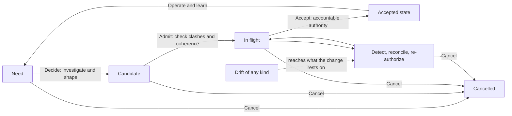

## Abstract

Agentic artificial intelligence has made producing software cheap. What has not become cheap is owning the result. Every change still lands in one shared system that customers and the business rely on. Someone still has to decide that the change was worth making, check that it does what was intended, run it, and answer for it when it fails.

The paper defines **software ownership** as a company's continuing capacity to decide, validate, run and answer for the software it depends on, whether that software runs the company's own operations or is what it sells. It argues that the second-order effects of agentic production make ownership the constraint, through two capacities that are not solved. The first is **single-change yield**: the share of changes that pass from intent to durable production without rework. The second is the capacity to bring many concurrent changes to one settled state that the organization can responsibly run; faster stages move work along without reducing the clashes between them. The two compound, and how they play out depends on the setting: the software being changed and how the AI is directed.

Drawing on Theory of Constraints, Lean product-development flow and database concurrency control, the paper names the parts of the problem. The **accepted state** is the one version of the system the company has accepted, and believes is running. **Changes in flight** are the many proposals to alter it, each built against a copy taken when work began. **Drift** is anything that makes that copy wrong before the change lands. The paper then states eight beliefs about what decides whether a change **converges**: lands in the one accepted state, consistent with the other changes accepted alongside it. It argues that ownership is the discipline that lets agentic scale produce durable value instead of faster rework, and it invites researchers and practitioners to establish software ownership as a field of research that tests, refines or overturns those beliefs.

Keywords: software ownership; agentic AI; software engineering; Theory of Constraints; Lean; work in progress; concurrency control; software architecture; requirements volatility; testing; accountability; flow management

## 1. Introduction: the second-order effects

AI can accelerate every phase of software development, from requirements and design through building, review, testing and release to incident triage. That first-order effect is no longer in question. This paper is about what follows from it.

When a team can expand capacity at any stage quickly and in parallel, production becomes **elastic**. Elastic does not mean infinite: models, compute, tool access, budgets, data, environments and orchestration all impose limits. It means an organization can start or advance far more changes than before, and produce far more reviews, tests, plans, documents and proposed fixes. None of that settles whether the changes are worth making, compatible with one another, correctly understood, safe to release, or still relevant by the time they finish.

The central claim of this paper follows.

> Agentic AI can make the capacity to produce changes elastic across the software lifecycle. It does not, in the same way, make it elastic to decide what is worth building, keep changes consistent with one another, know what has moved since each began, prove that each works, learn from running it, or answer for it.

Four second-order effects follow from that gap, and the paper is organized around them.

1. *Changes clash.* When starting work is cheap, many more changes are in flight at once, and every one of them acts on the same system. They read the same code, interfaces, data, policies and decisions, and many propose to change the same parts. Two such changes can each be correct alone and wrong together. A change can be built on a state of the system that another change has already replaced. The decisive constraint therefore cannot be assumed to be coding, review, testing or any other named stage. It is the organization's capacity to bring concurrent, consequential changes to one settled state that it can responsibly run, and that capacity is the core of what this paper calls **software ownership** (Sections 2 and 5 to 7).
2. *Each change still fails at some rate, and the rates multiply.* A change has to pass every stage from intent to production. Its quality, meaning how well tools, and the people who instrument and direct them, serve the system's long-term interest as well as the task in hand, decides whether it passes first time. This paper names the build-stage shortfall the **AI error rate**: the share of changes that are wrong as produced, judged against the snapshot they were built on. Some of these errors are caught before acceptance and cost rework in flight. Others pass acceptance because they work in the short term, and surface later as defects (Section 4.7). Whether the rate is falling is not settled, and reports from practice differ by setting (Section 3).
3. *Agents erode architecture one sound change at a time.* An agent takes the shortest path to the change it was asked for, and that path can cross a boundary that a person who understood the architecture would have kept. No single change shows the cost. It shows as a falling ceiling on how many changes the system can absorb at once (Section 4.4).
4. *The accountable person becomes the final constraint.* Automation can support every check, but a person with authority still has to accept each consequential change and answer for it. The better the agents become, the more the system has to be designed around that person's decision (Section 9).

The first two compound. Rework from failed changes lengthens the time every change spends in flight, more changes in flight make each one harder to get right, and each gain in tooling lowers the cost of starting a change, and so raises the number in flight. Section 8 states eight beliefs about these effects, Section 10 adapts Theory of Constraints to them, Section 11 proposes measures, and Section 13 sets out how the beliefs could be tested.

## 2. Software ownership: a proposed definition

This paper uses **software ownership** in a broader sense than authorship, repository permissions or the empirical idea of code ownership studied in the literature (Appendix B). A person may author a line of code, a team may own a service, and a company may own intellectual property. Each matters, and none is enough for the problem agentic production creates.

> Software ownership is a company's continuing capacity to decide, validate, run and answer for the software it depends on.

The software may run the company's own operations or be what it sells. Appendix A names eighteen established jobs that give the capacity its scope; writing new code is one job among many.

Ownership is a property of an organization, held through people, roles, records, operating practices and technical systems. It includes human judgment, but it does not require a person to inspect every generated token or perform every routine check, and automation is essential to it. What ownership demands of automation is that it serve an organization that keeps the legitimate authority to decide why a change exists, which trade-offs are acceptable, what evidence is enough, and who will answer when deployed behavior harms customers, breaks a commitment or fails under real conditions.

That authority cannot pass to a machine, and the reason is structural rather than a judgment about how capable machines are. This paper proposes that **ownership follows intent and liability**. Intent is the answer to why the software exists at all: which customers it serves, which obligations it meets, which risks the organization will carry for it. Liability is the duty to bear the consequences when it fails. A tool holds neither. It has no purpose of its own for the software, and it bears no consequence when the software harms someone. Ownership could move only if intent and liability moved together to the same party. When that happens in practice, as when a vendor contracts to run a system and to carry the liability for it, ownership moves to the vendor, which is another organization of accountable people, and not to the vendor's tools. Ownership can move between organizations. It cannot move to a machine. Automation can make the people who hold ownership far more capable; it does not replace them.

Throughout, this paper separates two systems that the word "system" can blur. The **software product** is the software itself, with its code, configuration, data, dependencies and operational behavior. The **software factory** is the organization that changes and runs it: its people, agents, tools, queues, decisions and practices. Work on the product is software engineering; work that improves the factory is **factory engineering**. Flow concepts such as changes in flight, arrival rate and throughput describe the factory. Coupling, a change's footprint (everything it alters) and architecture describe the product. Appendix H defines these and the paper's other terms.

## 3. Related work and reports from practice

"Conflict research" addresses parallel change in code, "flow research" addresses work in process and constraints, concurrency control addresses shared state with known read and write sets, and oversight research addresses the human role in automated systems (Appendix B). This paper joins them into one account of owning software when human labor no longer limits the number of changes in flight.

Reports on agentic production in 2026 disagree, and we do not treat them as settled evidence. Most come from vendors or survey firms with an interest in the result, one comes from a practitioner describing its own work, one is an academic working paper, and most report correlations. We read them as scenarios: settings in which challenges or successes are being seen and need to be understood.

| Setting | What was reported | Source and its limits |
| --- | --- | --- |
| A modern monorepo, worked by the vendor of the model with tools built for it | Merges rose from about 2,500 to over 30,000 a day in four months. A person still reviews every change, for intent rather than line by line, because agents "will sometimes violate core system constraints" [26] | First-party account; no rework or incident rates; the tooling is described as too specialized to offer outside |
| 22,000 developers in more than 4,000 teams, each team's lowest AI adoption compared with its highest | Incidents per pull request up 242.7%, median review time five times longer, 31.3% more pull requests merged with no review [27]. Among teams already at high adoption, incidents per pull request levelled off, up 14.5%, while monthly incidents rose 125.4% with volume and restarted work rose 66.7% [28] | Analytics vendor's telemetry; correlational; metrics standardized within each company, so companies cannot be compared |
| 718 firms on one engineering-analytics platform (Jellyfish), compared by when each adopted agents | Pull requests up 23% and commits up 20%, but no significant rise in issues resolved, ruling out a gain above 12%. Review time rose 49% and the share of pull requests sent back for changes nearly doubled [31] | Working paper by F. Chen and J. Stratton (Harvard), not peer reviewed; firm-level staggered difference-in-differences; the data partner reviewed it only for disclosure |
| 300 firms building mission-critical software on large C and C++ codebases | 81% had an incident caused by AI coding tools in six months; 35% of AI-generated code is not fully understood before release; 80% say agents struggle in large, complex codebases [32] | Survey commissioned by a debugging-tool vendor |
| A benchmark asking whether a maintainer would merge an agent's pull request | The best model scored 54.6%, and the top five sat within 2.5 points of one another [33] | The benchmark's owner sells a coding agent |

Read together, the reports conflict. One organization works at a volume no other reports, while the field telemetry shows more failure per change as adoption rises. Faros holds that strong engineering practice did not protect organizations, and sets that against DORA's 2025 finding that AI amplifies the strengths and weaknesses an organization already has [27]. We think both kinds of report can be true, because the settings differ in what decides the result: the software being changed, how the AI is instrumented and directed, and the tools. Legacy software, large and coupled, with much of its intent held only in people's heads, is harder for an agent to change correctly than a modern system built with agents in mind [32].

What these reports share is a set of relationships that should hold in any software factory, whatever its software or tools. When a change must pass several stages, the share that passes them all first time is lower than at any single stage, because each stage's losses add to the others. A busy step makes work wait, and the wait grows fast as the step nears full capacity. And the more changes are in flight at once, and the more of the same parts they touch, the more often they clash. The sizes are not universal. How often a stage passes a change, how busy a step runs and how much changes overlap all depend on the setting. Whether any one practice works in every setting is not known, and these reports cannot settle it.

## 4. What carries over from the factory, and what does not

Theory of Constraints and Lean are the most developed account of how work flows through a factory, and agentic development makes the software factory look more like one. This section takes what holds from them and sets aside what does not. Physical parts wait in line for one another, while software changes interfere with one another, and that difference shapes everything the paper goes on to argue.

### 4.1 What to take from Theory of Constraints and Lean

The lesson worth taking from Theory of Constraints and Lean is that local activity is not system progress. A physical factory can keep every worker and machine busy while orders run late and inventory grows. A software factory can do the same: generate more code, complete more automated reviews, execute more tests and open more work items, and deliver no more lasting value to customers.

### 4.2 Precedence dependency and shared-state dependency

The analogy between a physical factory and a software factory has a limit, and the limit is the kind of dependency between units of work.

In manufacturing, the dependencies are mostly **precedence dependencies**. A bill of materials and a routing say which parts must exist before which assemblies can be built, and in what order operations run. A late sub-assembly delays the assembly that needs it. The units themselves do not interfere with one another: building one gearbox does not change the design of the gearbox next to it.

In software, the main dependency is **shared-state dependency**. Software changes are not interchangeable parts moving through stations. Each change reads a shared, evolving system of code, interfaces, data, infrastructure, policy, operational behavior and decisions, and proposes to alter part of it. Two changes interfere when one alters something the other reads or alters. They need not be in sequence to clash; they clash because they act on the same system at the same time. A change can alter the meaning of another already in progress. A production incident can change release criteria overnight. A product decision can invalidate an architectural assumption. Software flow looks less like an assembly line than a set of concurrent transactions against one shared state.

That difference changes what flow management has to do. A physical factory manages queues in front of stations. A software factory also has to manage interference between the units in its queues, and interference grows with the number of units in flight, not only with their arrival rate.

### 4.3 Throughput

The right unit of throughput is therefore neither lines of code, agent tasks, pull requests, test cases nor deployments. This paper defines it as follows.

> Throughput is the rate at which the organization delivers changes that create intended value, are adequately evidenced and integrated, remain operable in production, and have been accepted by an accountable authority.

The definition does not require every release to be perfect or every risk removed. It requires that the residual risk be visible, and accepted by whoever is authorized to make that trade-off.

### 4.4 Architecture sets how much concurrency a system can absorb

Anthropic, describing its own agent-heavy engineering, reports that agents "will sometimes violate core system constraints", and that the engineers' role was often to tell the agent no [26]. Each change an agent makes can preserve the system's modularity, improve it, or erode it. An agent asked to complete one change tends to take the shortest path to it, and the shortest path can cross a boundary that a person who understood the architecture would have kept. A stream of locally reasonable agentic changes can erode the architecture while each change looks sound. The cost does not appear in any single change. It appears as a falling ceiling on how many changes the system can absorb at once, which is to say as lower future throughput.

No universal limit on changes in flight exists, because how much concurrency a system can absorb depends on how often its changes overlap, and that is set by its architecture and the mix of changes arriving.

### 4.5 A limited analogy from concurrency control

Database concurrency control offers a precise vocabulary for shared-state dependency, and this paper uses it as a limited analogy. Appendix C sets out the full mapping, and what the Universal Scalability Law adds to it.

The analogy has a clear limit. A database knows each transaction's read and write sets (what it reads and what it alters) exactly. Software does not. A change's footprint can be estimated from the code it touches, but much of what it rests on is implicit: an assumption about how a customer uses a feature, a decision recorded only in a meeting, a performance budget nobody wrote down. That is why detecting a clash between software changes is the hard part, and why noticing that something a change rests on has moved is the first step in keeping it current (Section 7).

### 4.6 Small batches

The Lean idea that carries over best to this problem is the small batch. Dividing a change into smaller changes before work starts has three effects in a shared-state system.

1. It shrinks each change's footprint, so fewer other changes overlap it.
2. It shortens each change's time in flight, so less drift reaches it before acceptance.
3. It converts a hidden clash into an explicit sequence. When a large change is split into parts that must land in order, the dependency between the parts becomes a precedence dependency, which flow methods handle well.

Splitting has costs. Every part must leave the accepted state coherent, so deciding how to split it needs design judgment. More parts mean more integration and acceptance events, each carrying its own overhead, so batch size trades the number of jobs against the overhead each job carries. Agentic production may move that trade-off. Agents can lower the cost of producing each small change, while the cost of holding a large change in flight, measured in drift and rework, rises with the number of other changes in flight. Both shifts favor smaller batches, up to the limit set by the cost of accountable acceptance for each.

### 4.7 The flow of one change

The argument so far concerns many changes at once. One change has a constraint of its own, and agentic production has not removed it.

A change passes through stages: deciding what it is for, building, reviewing, validating, releasing and running it. Each stage passes some share of the changes that reach it and sends the rest back. Manufacturing calls the product of those shares the rolled throughput yield [30].

> **Single-change yield** is the share of changes that pass from intent to durable production without rework.

Two things follow, and both are bad news for a factory that only speeds up its stages.

1. *Small losses at each stage add up to a large loss overall.* To pass first time, a change has to get through every stage. If each of six stages lets nine changes in ten through, only about half get through all six. Every stage looks healthy, yet nearly half the changes come back at least once. A weak stage anywhere drags the whole figure down. The worst case is a change built correctly to the wrong intent: no stage before the last can see the mistake, so it is found where fixing it costs most. The AI error rate, the share of changes that are wrong as built, measures only one of these stages, the build.
2. *A failed change costs more than the work of redoing it.* The redone change goes back into the same queues as new work, including the queue for acceptance by an accountable person. That step cannot be automated away, so it is the scarcest (Section 9). Waiting at a busy step does not grow in step with load. It grows sharply as the step nears full [29], [18]: a step that is 90% busy makes each change wait about six times as long as one that is 60% busy. So rework slows every change in the queue, including those that were right first time.

This arithmetic is the same in every software factory. The share each stage passes is not. It depends on the software being changed, on how the AI is instrumented and directed, and on the tools, which is why reports from practice differ so widely (Section 3).

## 5. One accepted state, many changes in flight

Software has no warehouse of unfinished widgets, and borrowing the word *inventory* can mislead. Code costs almost nothing to copy or store. Its cost lies in the attention, integration, evidence, rework, operational exposure and future understanding needed to turn a change into a durable outcome, and to keep owning the system afterward.

This paper distinguishes the one accepted state from the many changes in flight that propose to alter it.

### 5.1 Changes in flight

A **change in flight** is committed work that has started and has not yet become a validated, accepted and sustainably operable outcome. Lean calls the total work in progress. It includes active agent tasks, branches, generated diffs, pull requests, generated tests waiting for interpretation, incomplete migrations, behavior behind feature flags, release candidates and open follow-up actions.

A backlog item need not be in flight. An idea may be held deliberately as an option, and it enters flight once the organization commits attention or agent capacity to building, validating or integrating it. The distinction matters because an unstarted option usually costs far less to carry than a half-built change that interacts with others.

### 5.2 Changes to governing knowledge

Every change carries designed intent ahead of its implementation: the proposed requirement, the plan, the design, the new architecture rule, the revised policy, the changed test expectation, the edited agent instruction. These proposals are changes in flight too, until they are accepted. So are changes to governance that stand on their own, such as a new security policy or a revised agent skill still being drafted.

These artifacts are essential. Specification-driven development, for example, carries requirements explicitly through a specification, a technical plan, tasks, implementation and convergence [2]. Structured instructions and rules reduce ambiguity, encode lessons and make work more repeatable.

A change to governing knowledge carries the same cost as a change to code, one level up. Each proposed design is built against a snapshot of the accepted designs, and each may clash with another design in progress for the same part of the system. Two teams, or two agents, can each produce a sound plan for the same module, and the plans can be incompatible. A proposed change to a widely read artifact clashes with more than its neighbors. Every change in flight that read the old version of a security policy, an architecture rule or an agent skill is built on an assumption the new version withdraws. We believe changes to governing knowledge therefore have the largest read-set reach of any change, and deserve the most care at admission.

### 5.3 The accepted state

The **accepted state** is the version of the software product, and of the knowledge that governs it, that the organization has accepted. It includes deployed code, configuration, data contracts, dependencies, relationships between services, operational commitments, the accepted specifications, architecture, policies and tests, and the decision history needed to make sense of all of them. It is a record of what the organization has accepted and believes to be running, and the running system can depart from it (Section 7). Keeping enough understanding, evidence, operational visibility and accountable authority to change and run it safely is the continuing work of software ownership.

Three properties distinguish it from changes in flight.

It is **singular**. There is one accepted state at any moment, as a repository has one main line against many branches. Changes in flight are many proposed transformations of it, each built against a snapshot taken when the work began. Running more than one version at once does not break this: canary deployments, feature flags and several supported releases are all described by the one accepted state, which records which versions run where.

It is **append-only, not immutable**. Each accepted version is fixed once recorded, and the accepted state moves forward only through acceptance. The history is one sequence.

It is the **reference for every other copy**. Every change in flight is fresh or stale relative to the current accepted state, and every change must in the end be reconciled with that state rather than with the snapshot it began from.

One accepted state does not mean one change at a time. It means **serialized acceptance**: changes whose footprints overlap must be placed in an order, while changes whose footprints do not overlap can proceed and be accepted fully in parallel. Databases sustain very high concurrency against one committed state on this principle. The amount of parallelism a software organization can sustain is therefore governed by how often footprints overlap, and the architecture sets that: a system with clear boundaries between its parts lets more changes run side by side (Section 4.4).

Unlike changes in flight, the accepted state is not waste: working software is meant to last. Its size and how tightly its parts connect, though, set the future cost of change. The further the software has outgrown any one person's understanding, the more the organization depends on shared means of reconstructing intent, tracing dependencies, assessing impact and finding who has authority to decide.

### 5.4 Where each artifact sits

The model places every governing artifact in one of two states: accepted, and therefore part of the accepted state, or proposed, and therefore in flight.

| Artifact | Accepted state (one version) | In flight (many versions) |
| --- | --- | --- |
| Code and configuration | The main line and what is deployed from it | Branches, diffs, pull requests |
| Specifications and requirements | The accepted specification | Proposed edits, plans and task breakdowns |
| Architecture and design | Accepted architecture rules and decision records | Proposed designs and decisions |
| Tests | The accepted suite, which encodes the accepted expectations | New or changed expectations; generated runs awaiting interpretation |
| Policies, agent instructions and skills | The versions currently in force | Drafts and revisions |
| Runbooks and operational commitments | Current runbooks and service-level objectives | Proposed revisions |
| Decision authority | Current assignments of who decides what | Proposed reassignments |

The table makes one consequence plain. A specification is not a single document that many agents can safely edit at once. It has one accepted version and any number of proposed versions, and proposed versions of the same specification clash exactly as branches of the same code do. Section 6.3 develops what this means for specification-driven development.

Changes to code and changes to governing knowledge are coupled. More of one usually brings more of the other, and both join the accepted state once accepted. A healthy organization does not try to eliminate changes in flight. It stops them from growing faster than it can keep them coherent with the accepted state and with each other.

## 6. Why per-change controls leave the constraint in place

The tempting response to elastic code generation is elastic control. If agents produce more code, deploy AI reviewers. If testing becomes the bottleneck, generate more tests and run them in parallel. If documentation goes stale, have agents refresh it. If incidents rise, put agents on triage and repair.

Each of these interventions can help. They share one limit, and it is the reason none of them removes the constraint. **Each validates a change against its own snapshot.** A review reads one diff against the rules and code its author saw. A test suite runs one branch against the expectations encoded in it. A specification governs one change against the intent it recorded. None of them, as usually run, checks a change against the other changes in flight, or against the accepted state as it will be when the change lands. In database terms, they check that each transaction is consistent with itself; they do not check that the set of transactions can be accepted together. As the number of changes in flight rises, more of the failure moves into the space between changes, where per-change controls do not look.

Some established practices do check against the moving state. Continuous integration on the main line, trunk-based development and merge queues that test the combined result before the main line advances all serialize acceptance and catch clashes that branch-level checks miss. Their limit is timing. They detect a clash at the point of acceptance, after the clashing work has been done, so the rework cost has already been incurred. They are optimistic concurrency control: correct, and expensive in proportion to how often clashes occur.

### 6.1 Review scales inspection, not judgment

An AI review system can inspect thousands of diffs, apply formatting and policy rules consistently, flag dependency changes and retrieve relevant context faster than a person. That raises the capacity to inspect artifacts. It does not establish that the rules being applied are complete, current, consistent with each other or right for the trade-off at hand.

A review can be locally correct and globally wrong. Two changes can each satisfy every local rule and still conflict through a rule nobody wrote down. A change can conform to a policy that a production incident, a regulatory reading or a business decision has since made obsolete, or to a policy that another change in flight is about to revise. Better models can make each review sharper. They do not change the fact that the reviewer judges against one snapshot, when the question that matters is how the change will interact with everything else about to be accepted.

### 6.2 Testing: what each level can and cannot show

"Testing" covers several activities with different reach, and the claim that more tests do not amount to ownership has to be made level by level. Appendix D sets out what each level can show, and against which state.

Interference between concurrent changes appears at the integration, system and journey levels, and only when those tests run against the state the changes will actually join. Two changes can each pass every unit test and their own end-to-end tests, and still break the same customer journey together. The volume of tests per change says little about this. What matters is whether the tests that can see interference run against the right state, early enough to act on the result.

How much testing a change needs is a question of risk, not of volume. In the terms of this paper, the depth of validation a change needs grows with its blast radius (how much of the system and its users a failure would reach), the consequence of its failure, and how uncertain the organization is about what correct behavior is. Who decides the acceptable residual risk is not a testing question. It belongs to the accountable authority for that part of the system (Section 9). Testing supplies the evidence; acceptance decides whether the evidence is enough.

### 6.3 Specification-driven development moves the concurrency problem into the specification

Specification-driven development answers ambiguity and traceability. It moves important work earlier: stating what and why before how, writing plans and tasks, and using them to guide implementation [2]. Done well, it can reduce rework and make changes easier to review. It does not make intent permanently complete. Specifications drift from the world, because requirements volatility is ordinary: a survey-based empirical study found that it significantly affects schedule and cost overruns, and traced it to changing conditions among stakeholders and within organizations [23].

Nor does specification-driven development change the flow problem. The accepted specification is part of the accepted state and has one version (Section 5.4). Every proposed change to it is a change in flight. When many agents or teams work from the specification at once, each proposes edits against its own snapshot of it, and the proposed edits clash exactly as concurrent code changes do. A specification edited in parallel by a thousand agents is not a single source of truth; it is a thousand uncommitted transactions against one. Specification-driven development therefore moves the concurrency problem from code into the specification. That move can be valuable, because a clash found in a plan is cheaper than a clash found in code, but only if the organization detects and orders clashing specification changes before implementation starts.

### 6.4 The control stack is itself a coupled system

The organization uses code, tests, policies, documentation, tools and agents to govern code, and those governing assets are themselves generated, changed and interpreted by people and agents. Each change in flight may be revising some of them while it depends on others. As elastic capacity raises the rate of change, it raises the rate of parallel editing of the governing assets too, and every edit to a widely read asset clashes with all the work that read it.

> This does not lead to an endless chain of checks on checks in which no automation helps. It means the organization needs a capability one level up: knowing which version of each governing asset is accepted, which proposed versions are in flight, what has changed since a piece of work began, and who can resolve a clash. That capability belongs to software ownership.

## 7. Drift, freshness and the context-stability horizon

Every software change rests on a snapshot of the world. When it starts, it carries assumptions about customer need, business priority, architecture, interfaces, dependencies, data, security policy, operating conditions and the changes other teams are making. Any of those can shift while the change is in progress.

### 7.1 Drift

> Drift is any divergence between a copy and the source it is meant to match, arising after the copy was taken.

A change in flight is a copy of the accepted state, extended by a proposal. The accepted state is a copy too: a record of what the organization believes about its system and its world. Drift is what makes either copy wrong (Appendix E separates six kinds by origin: concurrent, intent, environmental, operational, record and structural drift). Concurrent drift is the kind that elastic execution multiplies, and the one per-change controls cannot see.

### 7.2 Three freshness relations

Freshness is a relation between a copy and its source. Three relations matter for software ownership.

1. *Fidelity* is the relation between the accepted state and the running system and the world. The accepted state is faithful when what the organization believes about its system, its dependencies, its customers and its obligations matches what is true.
2. *Currency* is the relation between a change in flight and the current accepted state. A change is current when nothing accepted since its snapshot alters what it rests on.
3. *Visibility* is the relation between a change in flight and the other changes in flight. Other changes in flight are not yet true, since it may never be accepted, so this is not freshness in the strict sense. It is early warning: knowing which proposals that overlap this one are likely to land, and when.

The relations form a hierarchy. Fidelity must hold before the other two can: a change that is perfectly current against an accepted state that is itself wrong about production is still wrong. Currency is the condition for converging, landing in the accepted state consistent with the other changes accepted alongside it, without rework. Visibility is the only relation that lets an organization act before a clash rather than after it.

Restoring any of the three relations takes three steps.

1. *Detect* that the source has moved in a way that matters to the copy.
2. *Reconcile* the copy with the moved source: rebase the branch, revise the plan, regenerate the implementation, update the test, correct the record.
3. *Re-authorize* the work: the accountable authority confirms that it is still worth doing under the new conditions.

Detection starts before work does. Before a change is admitted, its impact has to be analysed: what it will alter, what it rests on, and which other work touches the same parts. Where the analysis shows a likely clash, the code can be restructured first to reduce it. Much of what a change rests on is implicit (Section 4.5), so the analysis needs the system's history and the record outside the code, such as requirements, decisions and incidents, and not only a search of the code as it stands. Analysis up front does not remove the need for rework later. It can miss or misjudge an impact, requirements in the world outside can change, and the company can change direction.

The other two steps depend on the first. Nobody can reconcile an artifact with a change they do not know about, and no authority can re-judge a decision on conditions it has not been shown. Given detection, much reconciliation can be automated. Re-authorization still needs an authorized reading of purpose and acceptable risk, even when an agent gathers the evidence and proposes the options.

### 7.3 The context-stability horizon

Two periods in the life of a change need to be kept apart.

> The **exposure window** of a change is the time from the snapshot it was built against to its acceptance.

> The **context-stability horizon** of a change is the time from that snapshot to the first drift, of any kind, that alters something the change rests on.

> A change converges without rework if and only if it is accepted within its context-stability horizon.

Acceptance is what makes a change visible to everyone else as part of the accepted state, so that later work takes it into account in its own assumptions. A change accepted inside its horizon has done this cleanly. A change whose horizon ends first has to be detected, reconciled and re-authorized before it can be accepted, and any work that started from it inherits the problem.

The horizon has no universal length and is related to the change type. A small, isolated defect fix may stay valid for months. A data migration across services, a revision to security policy or an architectural change may meet drift within days or hours. The horizon depends on how fast the surrounding system changes and on how far the change's assumptions reach.

### 7.4 Techniques that reduce clashes

Two questions follow from the definition. How can fewer changes be blocked from starting because they would clash, and how can changes that have started meet less drift before acceptance?

Appendix F suggests techniques for both. Before admission, the aim is to keep clashing work from starting together. In flight, the aim is to shorten the exposure window, or to make drift visible and cheap to absorb.

## 8. What we believe about convergence

The earlier sections argue from established bodies of work. This section states what the paper believes follows from them, as eight beliefs about how an organization gets the outcomes it wants from agentic production: more accountable throughput, more changes that converge without rework. Each belief names the factors we think decide the outcome and says briefly why we hold it. Section 13 sets out the questions they raise.

### 8.1 States

A unit of work moves through four states, and can leave any of them by cancellation.

1. *Need.* A reason for change exists: a customer request, a field issue, an incident, a strategic objective, a regulatory obligation.
2. *Candidate.* The need has been investigated and shaped into a proposed change with a stated intent. Needs arrive from people and automatically, as alerts, advisories and failed checks, and a duplicated alert or a symptom of a deeper fault should not become a change in flight. Candidates are options, cheap to hold.
3. *In flight.* The organization has committed attention or agent capacity to the change (Section 5.1), and it is being built, validated or integrated against a snapshot of the accepted state.
4. *Accepted.* An accountable authority has accepted the change, and it has joined the accepted state.

Moving from Need to Candidate is deciding, and it needs someone with authority to settle conflicts, such as whether reliability work outranks a feature or an incident changes the release plan. Moving from Candidate to In flight is admission, whose constraint is coherence: two small changes can still be unable to run together if they overlap, which is why a flat limit on changes in flight fails. Moving from In flight to Accepted is acceptance by an accountable authority (Section 9). Drift that reaches a change in flight sends it through reconciliation before it can be accepted. Operating the accepted state supplies evidence no earlier stage can, keeps the record faithful to the running system, and shapes what is decided next.

### 8.2 Eight beliefs

1. **Among changes that are each correct, how much work converges depends on how much is in flight and how much of it overlaps.** Changes interfere through shared state, so speed helps only by shortening each change's exposure to drift (Section 4.2).

2. **Single-change yield is not solved, and how high it is depends on the software being changed and on how the software factory is built.** A change must pass every stage first time, so a shortfall at any one stage lowers the whole, and the same tools pass far more changes first time on a modern system built for agents than on a large, tangled legacy one (Sections 3 and 4.7).

3. **Architecture sets how many changes in flight a system can absorb, and every accepted change raises or lowers that limit.** Agent capacity spent lowering overlap therefore does more than capacity spent producing changes (Section 4.4).

4. **Small changes, accepted early, meet less drift.** They overlap fewer others and spend less time in flight, up to the overhead of each acceptance (Section 4.6).

5. **Seeing a clash early costs less than fixing it late, except where an agent can cheaply rebuild the change against the new state.** A check at acceptance comes after the rework is done; regenerating is cheap, deciding and validating again are not (Sections 6 and 8.3).

6. **Better tools can raise yield, but they invite more work.** Cheaper starts put more changes in flight; in one field dataset, failures per change levelled off while total failures kept rising (Section 3).

7. **However good the system becomes, the accountable person remains the final constraint, so the system has to be designed to serve that person's decision.** Ownership follows intent and liability, which no tool holds (Sections 2 and 9).

8. **Single-change yield and convergence under concurrency compound.** Rework lengthens every change's time in flight, and more changes in flight lower yield. Past some load the loop runs away into a **non-convergent rework regime**: local agent metrics look excellent while queues lengthen, context goes stale and operational risk grows (Appendix G.4).

These eight beliefs are a starting set, and neither they nor the factors they name are complete. Testing, refining and extending them is the work Section 13 invites.

### 8.3 Admitting a change that is predicted to clash

When a candidate is predicted to overlap with work already in flight, the organization has four choices.

1. *Wait.* Hold the candidate until the overlapping work is accepted, then start it against the new state.
2. *Stack.* Build it explicitly on top of the overlapping change, as a declared sequence.
3. *Split.* Separate the overlapping part from the rest, admit the rest now, and sequence the overlapping part.
4. *Admit and reconcile.* Start it now and accept that it will meet drift and need reconciliation.

The choice is economic. Waiting costs the delay to the value the change would deliver. Admitting a clashing change costs the expected rework. When people wrote the code, rework meant writing it again. When agents write it, regenerating is cheaper, though deciding again that the change is wanted and checking again that it is correct are not.

## 9. Accountable acceptance

The last step before a change joins the accepted state is acceptance, and acceptance is where accountability is exercised. An organization can delegate implementation and routine enforcement widely. It cannot delegate away its commitments to customers, regulators, employees, counterparties and its own operators. Under ordinary legal and contractual arrangements an autonomous tool does not become the responsible party (Section 2). The organization and the people it designates keep the obligation to decide and to answer. A person placed solely at the point of acceptance does not make acceptance accountable. Research on automation shows why: it leaves people with the hardest parts of a task while removing the practice that keeps them able to do those parts [4], and people over-rely on automated aids in ways that training and instructions do not prevent [5]. A person approving a stream of agent-produced changes, each presented as passing every check, is in exactly that position, and their approval is a ritual unless the system around them is built to make it a decision.

Article 14 of the EU AI Act lists, for high-risk AI systems, what people assigned to oversight must be enabled to do: understand the system's capacities and limitations and monitor its operation, remain aware of the tendency to over-rely on its output, interpret its output correctly, decide not to use it or to override or reverse its output, and interrupt it through a stop button or similar procedure that brings it to a safe halt [6]. Software change is not, in general, within the scope of that article, but its list maps closely onto what accountable acceptance needs. What accountable acceptance requires of software change has still to be established. The following six conditions are one candidate set.

1. *Decision rights.* The person has the authority to accept, and the right to refuse without penalty. Acceptance that cannot be refused is not acceptance.
2. *A brief they can decide from.* The person sees, in a bounded form, the change's intent, its footprint and blast radius, what changed in the system while it was in flight, the evidence for it and the gaps in that evidence, and the residual risk they are being asked to accept.
3. *A decision load within human limits.* The volume of acceptances each person faces is kept within what they can judge. Changes below an explicit delegation boundary are accepted by automated policy, so that only consequential decisions reach people.
4. *A recorded decision, traceable to a person.* Who accepted what, on which evidence, is recorded, so that the decision can be reconstructed and answered for.
5. *The means to stop and reverse.* The person can halt a release, roll it back or disable it, and the system is built so that doing so is safe.
6. *Feedback on past decisions.* The person sees how the changes they accepted behaved in production, so that their judgment stays accurate.

Conditions like these are how ownership is instrumented. Each of them can be supported by automation; none of them can be performed by it. They matter more as agents improve, because the accountable person is the one constraint automation cannot remove (Section 8, belief 7), so the interface provided towards that person is the most critical design factor for the total system.

Software, and the systems that produce it, exist to serve people first and machines second.

## 10. Flow management under shared-state dependency

Theory of Constraints directs attention to the one part of a system that limits its throughput [7]. In a physical factory, that part is a station: a machine or work centre whose capacity is lower than the demand on it. Under shared-state dependency, the constraint is usually somewhere else. It is a **hot region of the software product**, such as a core module, a central schema, a shared library or a widely read specification, through which many changes must pass and in which they collide, together with the decision capacity that governs that region. Goldratt gave Theory of Constraints a five-step method for managing a constraint, which he called the five focusing steps: identify the constraint, exploit it, subordinate everything else to it, elevate it, and repeat [7]. The steps still apply, read in these terms.

1. *Identify the constraint.* Find the regions where changes most often overlap, wait on one another or are reworked. The history of which parts of the system change together, and of where rework and reverted changes cluster, points to them.
2. *Exploit the constraint.* A hot region can accept only a limited number of changes in a given period. Spend that capacity on the most valuable changes, sequence them so that each lands on the state the next expects, and make sure each arrives with its evidence, current context and a named path to a decision.
3. *Subordinate admission to the constraint.* Do not use elastic generation to start more work in a hot region than it can accept. Admission elsewhere can run freely where footprints do not overlap; admission into the hot region follows its capacity.
4. *Elevate the constraint.* Modularize the hot region so that fewer changes have to pass through it: separate its concerns, put stable contracts at its boundaries, split shared schemas and libraries. In a physical factory, elevating a constraint means capital, hiring and time, and comes last for that reason. In agentic production, agents may make much refactoring cheaper, and widening a hot region lowers overlap for every future change. The capacity that floods the system with starts can be turned to raising what can finish, and this step deserves more weight than its place in the sequence suggests.
5. *Repeat.* Relieving one region exposes the next. The aim is continuing management of a system that keeps changing, and a pipeline built once cannot meet it.

Where limits on starts are needed, they should be weighted by overlap rather than counted. A useful policy weights each change by its blast radius, the centrality of the parts it touches, how hard it is to undo, the sensitivity of its data, its security or regulatory consequence, the uncertainty of its validation, and how fast its surrounding context changes. The point is to make visible that different changes draw different amounts of shared ownership capacity, and no universal score needs to come out of it.

How critical a change is belongs here too. A change does not become critical because an agent can produce it quickly or because work has already gone into it. It is critical when it carries high expected value or obligation, has a defensible path to convergence, and outranks competing claims on scarce ownership capacity. An obsolete or weakly evidenced change should be stopped early even when it is nearly complete, since sunk implementation effort is no reason to keep it in flight.

Each of these steps needs people with authority over the region, supported by systems that show them overlap, drift and the state of each change in flight. Clear ownership scopes and decision rights let separate work run freely and route each decision to someone who can make it.

## 11. Measures that reflect durable throughput

A software factory turns dangerous when it measures what is easiest to count instead of what it needs to optimize. In agentic environments, lines generated, agent runs, pull requests opened, test cases executed, reviews completed and deployments started are all useful operational signals, and none measures durable value directly.

A measurement system for software ownership should ask eight questions.

1. How many changes are in flight, and how long is each exposed? Count them across the whole value stream, changes to specifications, policies, tests and instructions as well as to code, and track the spread of exposure windows, not only their average, since the longest-exposed changes are the ones most likely to meet drift.
2. How much do the changes in flight overlap? We believe this quantity decides how much correct work converges (Section 8, belief 1), and it is rarely measured. Historical co-change, the record of which parts of the system have changed together, is one practical proxy.
3. How much rework is the system creating, and how much of it comes from each kind of drift and how much from the AI error rate, the share of changes that are wrong as built? The split matters: rework from drift falls only with fewer changes in flight or less overlap, and rework from errors only with better tools and better use of them.
4. How quickly is drift detected? Measure the delay between a material drift event and the moment the owner of the affected work learns of it, and how long the accepted state stays out of step with the running system.
5. Can the organization explain and accept what it ships? The test is whether it can reconstruct a decision and name its accountable authority, not the volume of paperwork, and whether each accountable person's decision load stays within what they can judge.
6. Is the architecture holding? Rising overlap with the number of changes in flight held steady is the signature of structural drift, the slow erosion of the architecture by accepted changes that each looked sound, and an early warning that the ceiling on concurrency is falling.
7. Does delivered software create durable outcomes? A release that ships quickly and immediately causes incidents, churn or unplanned corrective work is no evidence of higher sustainable throughput.
8. How many changes pass each stage first time, and how does that differ between teams and systems? Compare like with like, such as the same tools on legacy and modern software, since the setting decides much of the result.

These measures exist to improve the system, never to rank individuals or punish teams. Used that way, they would recreate the failure of local efficiency that Theory of Constraints and Lean warn against, in which people optimize visible activity while the real constraint and the accumulated inventory stay hidden.

## 12. What this paper rejects

The theory rejects five conclusions that are sometimes drawn from arguments like it.

1. *AI should be slowed to keep a human-centered workflow.* The objective is higher sustainable throughput, and automation raises it when it reduces overlap, shortens exposure, improves evidence and strengthens operational learning (Section 10).
2. *Every change needs exhaustive specification up front.* Where things change fast, premature specification becomes stale inventory of its own. The model asks for intent and evidence that are sufficient, current and in proportion to risk.
3. *A human must approve every low-risk action.* Routine decisions can be delegated, provided the boundary of delegation, the evidence, the path for exceptions and the accountable authority are explicit.
4. *The single change is solved, leaving only scale.* Changes still fail in many settings (Section 3), and a gain in yield can be lost to the queue that more changes in flight build (Section 8).
5. *A tool can own software.* Ownership follows intent and liability, and a tool holds neither (Section 2). In our reading that has held for every earlier generation of software tooling, and agentic tooling does not change it.

## 13. Software ownership as a field of research

This paper does not settle the questions it raises. It proposes that software ownership be studied as a discipline in its own right, whose object is an organization's capacity to decide, converge, run and answer for the software it depends on, and it invites researchers and practitioners to take up that study.

The eight beliefs of Section 8 give the field its first questions.

1. How much overlap can a given system carry before more changes in flight lower what it delivers?
2. What decides single-change yield in a given setting, and does any practice raise it across settings, from legacy to modern software?
3. Can the erosion of a system's architectural limit on concurrency be measured before it shows up as lost throughput?
4. At what size does the overhead of each acceptance outweigh the drift a smaller change avoids?
5. How accurately can a clash be predicted from what is known about a change before work on it starts?
6. Does a falling error rate raise durable throughput, or mostly the number of changes in flight?
7. What must a decision brief contain, and how many consequential decisions can a person make well in a day?
8. Does yield fall as the number of changes in flight rises with tools held fixed, and at what load does the loop between them run away?

The field needs two things before it can answer them: a shared vocabulary and agreed measures. The paper's terms, from the accepted state and changes in flight to overlap, drift, the context-stability horizon and accountable acceptance, are a proposal for the first. Section 11 sketches the second. We believe overlap matters as much as yield and is measured least, and until it is measured the first belief, that overlap decides how much correct work converges, can be argued but not tested.

Several kinds of study could then test the beliefs.

1. *Simulation.* Model a flow of changes against a shared state, vary the number of changes in flight, overlap, drift and error rates, and see whether delivered throughput rises, peaks and falls as overlap and the loop between rework and changes in flight would predict (Section 8, beliefs 1 and 8). Appendix G gives one starting formalisation, and G.4 reports a first simulation.
2. *Mining change histories.* Repositories, review systems and incident records hold which parts of a system changed together, which changes were reworked or reverted, and how long each was in flight. Co-change gives a proxy for overlap, and the histories can show whether rework rises with changes in flight and overlap together.
3. *Controlled experiments with agent teams.* Agents make it cheap to run the same body of work many times under different conditions: more or fewer changes in flight, different batch sizes, different admission policies, different architectures of the same system. Experiments like these were rarely practical at scale with human teams.
4. *Field studies of acceptance.* Observe the people who accept changes, the load they carry, what they are shown and how their decisions turn out in production, to test whether the accountable person is the final constraint, and which conditions make acceptance a real decision (Section 9).
5. *Design research.* Build and evaluate the tools the beliefs call for: clash prediction before admission, drift detection in flight, and decision briefs for accountable people.

The work draws on code ownership, parallel development, flow, concurrency control and human oversight of automation (Appendix B), and it needs people from each of them, working with the people who run software organizations. Some of the beliefs may prove wrong. The questions need answers now, while organizations are deciding how to use agents, and answering them will take researchers and practitioners working together.

## 14. Conclusion

Agentic AI has made producing software cheap. Code, and much of the work around it, from review and testing to documentation and incident triage, can now be produced at a speed and scale no team of people could match. Looking for the one stage agents have not yet accelerated is therefore the wrong response. The constraint has moved from producing changes to owning what they do to the one system everyone depends on.

The paper's argument comes down to six points.

1. Every change acts on the same system. When many more changes are in flight at once, they clash. Two changes can each be correct alone and break the system together, and a change can be built on a version that has already been replaced. Faster review and testing do not prevent this, because each check looks at one change against the version its author started from.
2. Getting one change right is not solved either. A change has to pass every stage from intent to production, and small losses add up: six stages that each pass nine changes in ten pass only about half first time.
3. The two problems feed each other. Rework keeps changes in flight longer, which makes clashes more likely, and more clashes mean more rework. Past some load the loop runs away: agents look busy and productive while less and less work reaches production in a state anyone can run.
4. Architecture sets how many changes a system can take at once. Agents taking the shortest path to each task can erode it one sound change at a time, and the cost shows only later, as a lower ceiling.
5. The cheapest protection is small changes, accepted early, and clashes seen before work starts. Agent capacity spent untangling the busiest parts of the system does more good than capacity spent producing more changes.
6. A person still has to accept each consequential change and answer for it, because no tool holds the purpose behind the software or the liability for it. The better the agents become, the more that person's decision is the final constraint, and the system has to be built to serve it.

Software ownership is the name this paper gives to the capacity that deals with all six: a company's continuing capacity to decide, validate, run and answer for the software it depends on. We expect the organizations that succeed to be the ones that use agents to raise that capacity faster than they raise the number of changes in flight. Maximizing agent activity will not get them there.

These are beliefs, not findings. Section 13 sets out the questions they raise and the studies that could test them, and we invite researchers and practitioners to take them up.

## Appendix A. The eighteen jobs of software ownership

The eighteen jobs give the capacity its scope. They are named, not exhaustive: a representative set of the established activities that owning software involves, each an established part of software engineering as the field's body of knowledge describes it [8], or a category of software maintenance as the international standard defines it [9]. Other activities, such as capacity planning, cost management or data stewardship, belong to the same capacity, and an organization's own list will differ in its detail. Writing new code is not in the table: it would be a nineteenth job, and is one among many in practice.

| # | Job | Established term and source |
| --- | --- | --- |
| 1 | Requirements | Software requirements [8] |
| 2 | Architecture | Software architecture [8] |
| 3 | System design | Software design [8] |
| 4 | Code review | Software quality [8] |
| 5 | Testing | Software testing [8] |
| 6 | Release and deployment | Software engineering operations [8] |
| 7 | Observability | Software engineering operations [8] |
| 8 | Incident response | Software engineering operations [8] |
| 9 | Debugging | Corrective maintenance [9] |
| 10 | Root cause analysis | Corrective maintenance [9] |
| 11 | Refactoring | Perfective maintenance [9] |
| 12 | Performance tuning | Perfective maintenance [9] |
| 13 | Dependency upgrades | Adaptive maintenance [9] |
| 14 | Migrations | Adaptive maintenance [9] |
| 15 | Security patching | Software security [8]; preventive maintenance [9] |
| 16 | Tech debt | Preventive maintenance [9] |
| 17 | Configuration management | Software configuration management [8] |
| 18 | Onboarding | Software engineering professional practice [8] |

## Appendix B. Related work

### B.1 Code ownership

Empirical work on code ownership measures how the contributions to a component are distributed among developers. Bird and colleagues found, on Windows Vista and Windows 7, that ownership measures such as the number of minor contributors and the share of changes made by the top contributor were related to pre-release faults and post-release failures [10]. A replication across four further Microsoft products confirmed the relation at file and directory level [11]. That literature treats ownership as authorship. This paper uses the word for the organizational capacity of Section 2, which can be intact when no individual wrote most of the code.

### B.2 Parallel development and conflicts

Parallel change is a long-standing subject in software engineering research. Perry, Siy and Votta studied the change history of a large legacy system to understand the problems of parallel development [12]. Brun and colleagues studied nine open-source systems and found that conflicts between developers' copies of a shared project were frequent and persistent, and that they appeared not only as overlapping textual edits but as later build and test failures; their tool, Crystal, detects such conflicts early through speculative analysis of version-control operations [13]. Sarma, Redmiles and van der Hoek's Palantír gives developers awareness of relevant parallel changes in other workspaces, and their experiments found earlier detection and resolution of more conflicts [14]. Kasi and Sarma's Cassandra goes a step further: it identifies likely conflicts before work starts, expresses them as constraints, and proposes task schedules that minimize them [15].

This paper treats conflict as the central mechanism of software flow, and extends it beyond code to every artifact that governs a change.

### B.3 Flow: Theory of Constraints, Lean and product-development flow

Goldratt's Theory of Constraints holds that the throughput of a system is set by its constraint [7], with the five focusing steps Section 10 applies. Gupta and Boyd argue that the theory can serve as a general theory of operations management, chiefly because it avoids the pitfalls of local optimization, while noting that it has mostly not been tested empirically [16]. Lean production, as Ohno described it at Toyota, stresses flow, the removal of waste and production pulled by demand [17]. Both were built for repetitive physical production. Reinertsen adapted flow thinking to product development and argued that unmanaged queues are the main cause of poor product-development performance, that queue size is a leading indicator where cycle time trails, and that batch size is an economic trade-off between holding cost and transaction cost rather than a quantity to minimize at any cost [18]. Kanban, as Anderson and Carmichael describe it, balances the demand for work against the capacity to start it, and marks the point at which an item is committed to [19]. DORA, the DevOps Research and Assessment program, applies limits on work in process to technology work [1], and Forsgren, Humble and Kim found that high delivery performance is possible with all kinds of systems provided the systems, and the teams that build them, are loosely coupled [20].

### B.4 Concurrency control and scalability

Database research solved a version of this paper's problem: many transactions act on one shared state, and the result must equal some order of them. Berenson and colleagues showed that the ANSI SQL definitions of isolation levels were incomplete, and defined snapshot isolation, in which each transaction works from a snapshot of the committed state [21]. Gunther's Universal Scalability Law models how the throughput of a system changes as concurrency rises, through two costs: contention for shared resources, and the coherency delay of keeping shared state consistent [22]. Section 4.5 and Appendix C use both, as a limited analogy.

### B.5 Human oversight of automation

Bainbridge's "Ironies of automation" observed that automating most of a task leaves people with the parts that cannot be automated, while depriving them of the practice they need to do those parts well [4]. Parasuraman and Manzey reviewed automation complacency and automation bias and concluded that both are overlapping, attention-driven phenomena that training and instructions do not prevent [5]. Regulation now states what effective oversight requires: Article 14 of the EU AI Act lists the capabilities a person assigned to oversee a high-risk AI system must be enabled to exercise [6]. Section 9 draws on all three.

## Appendix C. The database analogy and the Universal Scalability Law

| Database concept | Software counterpart |
| --- | --- |
| Committed state | The one accepted state of the software product (Section 5.3) |
| Transaction | A change in flight |
| Snapshot read | The state of the system and the world a change was built against |
| Read set | Everything the change rests on: code, interfaces, data, decisions, intent, policies, tests |
| Write set | The change's footprint: everything it alters |
| Commit | Acceptance into the accepted state by an accountable authority |
| Pessimistic locking | Admission control: a clashing change waits before it starts |
| Optimistic validation and retry | Detecting a clash at integration and reworking the change |
| Write skew | Two changes, each correct against its snapshot, that jointly break an invariant |

The Universal Scalability Law states the consequence for throughput. Gunther models relative capacity at concurrency \(N\) as \(C(N) = N / (1 + \alpha(N-1) + \beta N(N-1))\), where \(\alpha\) is the cost of contention for shared resources and \(\beta\) the cost of keeping shared state coherent [22]. With any coherency cost, throughput rises with concurrency, peaks, and then falls. In a software organization, contention is changes waiting on the same scarce decision or the same region of the system, and coherency is the work of keeping changes in flight consistent with one another and with the accepted state. The law gives a formal reason to expect that adding concurrency past some point lowers throughput, and the argument of Section 4.4 says where that point lies: it depends on the architecture.

## Appendix D. What each level of testing can show

| Level | What it gives evidence of | Against which state | Can it see interference between changes? |
| --- | --- | --- | --- |
| Unit | A unit behaves as its author expected | The change's own snapshot | No |
| Integration | Units or services work together | The snapshot, unless run against the main line | Only when run against the accepted state with other changes included |
| System and non-functional (load, performance, security, resilience) | Properties of the whole system | An environment | Only if the environment reflects the current accepted state |
| Acceptance and end-to-end | Customer journeys meet intent | Usually a shared environment | Yes, where changes touch the same journey |
| Verification in production (canary release, observability) | Real behavior under real use | The running system | Yes, but after the change is live |

The lower levels give evidence about a change in isolation, and that is where agents generate most tests.

## Appendix E. Six kinds of drift

| Kind | Origin | What it breaks (Section 7.2) |
| --- | --- | --- |
| Concurrent drift | Another change is accepted and alters something a change in flight rests on | Currency |
| Intent drift | The organization's own purpose, priorities or stakeholders change | Currency of the decision behind the change |
| Environmental drift | The world outside changes: customers, market, regulation, third-party dependencies and interfaces, threats | Fidelity, then the currency of dependent work |
| Operational drift | The running system departs from the accepted state without an accepted change: configuration drift, emergency fixes, shifts in data, infrastructure changes, changed behavior of embedded AI models | Fidelity |
| Record drift | The written and remembered record departs from the accepted system: stale specifications and decision records, inconsistent comments, understanding lost when people leave | Fidelity within the accepted state |
| Structural drift | Accepted changes, each acceptable alone, erode the intended architecture [24] | No relation directly; it raises overlap between future changes and lowers the ceiling on concurrency |

Concurrent drift is the kind that elastic execution multiplies, and the one per-change controls cannot see. Intent drift is the kind requirements research has long measured [23]. Record drift has support at the simplest level: mining 1.3 billion AST-level changes across 1,500 systems showed that keeping comments consistent with code takes substantial ongoing effort [25]. No record maintains itself because it is written down or handed to an agent. Structural drift makes no single change stale, but lowers the concurrency the system can absorb in future (Section 4.4).

## Appendix F. Techniques that reduce clashes

Before admission, the aim is to keep clashing work from starting together.

1. *Predict footprints.* Estimate each candidate's read and write sets, including from co-change history.
2. *Schedule with clashes in mind.* Choose which candidates to admit together so that their footprints do not overlap, as Cassandra does for developers' tasks [15].
3. *Split.* Divide a large change into smaller ones with smaller footprints, sequenced explicitly (Section 4.6).
4. *Accept the contract first.* Accept an interface change on its own, then build the implementations in parallel against it.

In flight, the aim is to shorten the exposure window, or to make drift visible and cheap to absorb.

1. *Keep batches small,* so that each change spends less time in flight.
2. *Accept structure early.* Commit a change to the accepted state behind a disabled flag, so that its structure becomes part of what others build on before its behavior is released.
3. *Publish intent before acceptance.* Show a change's footprint and purpose to other changes in flight while both are cheap to adjust.
4. *Stack dependent work.* Build a change explicitly on top of the in-flight change it depends on, turning a hidden clash into a declared sequence.
5. *Reconcile continually.* Absorb drift in many small reconciliations, since cost grows with distance from the source.
6. *Expand, then contract.* Keep old and new forms valid until every dependent change has moved.
7. *Regenerate from preserved intent.* Discard a drifted implementation and regenerate it against the current state from its recorded intent and acceptance criteria.

## Appendix G. A candidate formalisation of the convergence model

This appendix puts the first and eighth beliefs of Section 8 into equations, as one way among several of doing so. Its quantities, including the number of changes in flight at which rework-free throughput peaks and the share of changes that converge at the peak, are predictions to test rather than findings. They rest on strong assumptions, stated at the end.

| Symbol | Meaning |
| --- | --- |
| \(L\) | Changes in flight (work in progress) |
| \(\lambda\) | Rate at which changes are admitted |
| \(X\) | Rate at which changes are accepted (throughput) |
| \(X_0\) | Rate at which changes are accepted without rework (rework-free throughput) |
| \(\gamma\) | Rate at which changes in flight are cancelled |
| \(W\) | Mean exposure window |
| \(p\) | Probability that a given accepted change alters something a given change in flight rests on (overlap) |
| \(\delta\) | Rate at which drift of the other kinds reaches a given change in flight |
| \(\varepsilon\) | AI error rate: probability that a change is found wrong before acceptance, judged against its own snapshot |
| \(h\) | Context-stability horizon of a change |
| \(Y\) | Yield before acceptance: the product of the stage yields up to acceptance, of which \(1-\varepsilon\) is the build-stage part |
| \(s\) | Mean time the acceptance step spends on one attempt |
| \(\rho\) | Utilization of the acceptance step |

### G.1 The flow balance

The number of changes in flight evolves as

\[
\frac{dL}{dt} = \lambda - X - \gamma
\]

Rework does not add changes to this count. It keeps changes in flight longer, which lengthens \(W\), and it consumes capacity that would otherwise have accepted other changes, which lowers \(X\). When \(\lambda\) persistently exceeds \(X + \gamma\), \(L\) grows, and by Little's Law the exposure window grows with it.

### G.2 Converging without rework

Consider one change in flight. During its exposure window, about \(XW\) other changes are accepted. Suppose each alters something this change rests on with probability \(p\), independently, and that the other kinds of drift reach it at rate \(\delta\). If both kinds of event arrive as Poisson processes, the probability that the change is accepted inside its horizon is

\[
P(h > W) \approx e^{-(Xp + \delta)W}
\]

In a stable software factory Little's Law gives \(XW \approx L\) [3]: the number of changes accepted while one change is in flight is about the number in flight. A change converges without rework when it is also correct as produced. If it is found wrong before acceptance with probability \(\varepsilon\), independently of drift, then

\[
P(\text{converge without rework}) \approx (1-\varepsilon)\, e^{-(pL + \delta W)}
\]

### G.3 Where rework-free throughput peaks

Little's Law also gives \(X \approx L/W\). Multiplying by the probability above gives the rate at which changes converge without rework:

\[
X_0(L) \approx \frac{L}{W}\,(1-\varepsilon)\, e^{-(pL + \delta W)}
\]

Treat \(W\) as fixed, set by how fast each stage runs. Then \(dX_0/dL\) is proportional to \((1 - pL)\,e^{-pL}\), which is zero at \(L^*= 1/p\). Below \(L^*\), admitting more work raises rework-free throughput; above it, admitting more work lowers it. The peak value is

\[
X_0(L^*) \approx \frac{1-\varepsilon}{e\,pW}\, e^{-\delta W}
\]

and at the peak the probability of converging without rework is \((1-\varepsilon)\,e^{-1-\delta W} \le e^{-1} \approx 0.37\). Neither \(\varepsilon\) nor \(W\) appears in \(L^*\). In this uncoupled model both change the height of the peak, and only overlap sets where it lies. Section G.4 shows that the result does not survive once yield and the exposure window are allowed to depend on the load.

The peak is not a state free of rework. It marks the point past which admitting one more change removes more rework-free acceptances from other changes than it adds, a different limit from the non-convergent rework regime of the eighth belief (Section 8.2), where admission outpaces acceptance and cancellation altogether. Errors that pass acceptance and fail later do not enter \(\varepsilon\). They act as structural or record drift (Appendix E), and they raise \(p\) for the changes that follow.

The assumptions are strong. Overlap is not independent across changes, drift does not arrive at a constant rate, \(p\) differs from one change to the next, and \(W\) is not fixed: rework lengthens it, so beyond \(L^*\) the fall is steeper than the expression shows. Section G.4 takes this up. The expressions are illustrative. Whether real systems show their shape is one of the questions Section 13 invites research to answer.

### G.4 Coupling yield and concurrency

Sections G.2 and G.3 treat the exposure window as fixed and the yield before acceptance as a constant. Relaxing both shows one way the two constraints of Section 8 could compound.

A change that fails, whether because it was wrong or because drift reached it, is reworked and returns, so the share of attempts at acceptance that succeed is \(Y e^{-(pL+\delta W)}\), with \(Y\) in place of \(1-\varepsilon\). If acceptance is a single step with mean service time \(s\), its utilization is

\[
\rho \approx \frac{X s}{Y\, e^{-(pL + \delta W)}}
\]

and the wait in front of it grows as \(\rho/(1-\rho)\), faster still when rework makes arrivals irregular [29]. The window is the time to build plus that wait, and it feeds back: it sits in \(e^{-\delta W}\), and through \(L \approx XW\) it raises the number of changes in flight in \(e^{-pL}\). Both lower the share of attempts that succeed, which raises \(\rho\) and lengthens the window again. Below some rate of admission the loop settles. Above it, \(L\) grows until admission stops or work is cancelled: the non-convergent rework regime of the eighth belief, reached here through queueing rather than assumed. Because \(\rho\) carries \(1/Y\), lower yield brings collapse at a lower rate of admission.

Yield enters rework-free throughput twice, as the share of changes that are correct and through the longer wait, so a fall in yield lowers the peak of \(X_0\) by more than its own proportion. A yield that falls as \(L\) rises also moves the peak to fewer changes in flight, so G.3's result that only overlap sets the peak holds only in the uncoupled model. Errors that pass acceptance enter through \(p\), not \(Y\).

A discrete-event simulation of the model reproduced these shapes. Lowering yield from 0.8 to 0.5 cut the peak by more than half; a steep fall in yield with load moved the peak from 22 changes in flight to 12; and in every run the peak sat where acceptance neared saturation, well below \(1/p\). The simulation shares the model's assumptions and tests its algebra, not the world.

## Appendix H. Glossary

| Term | Definition |
| --- | --- |
| Software product | The software itself: code, configuration, data, dependencies and operational behavior |
| Software factory | The organization that changes and runs the software product: people, agents, tools, queues, decisions and practices |
| Factory engineering | Work that improves the software factory, as software engineering is work on the product |
| Software ownership | A company's continuing capacity to decide, validate, run and answer for the software it depends on |
| Accepted state | The one accepted version of the software product and the knowledge that governs it, with its append-only history (Section 5.3) |
| Change in flight | Committed work, to code or to governing knowledge (specifications, designs, rules, policies, tests, instructions), that has not yet been accepted; Lean calls the total work in progress |
| Commitment point | The point at which a candidate becomes a change in flight |
| Footprint | Everything a change alters (its write set) |
| Assumptions | Everything a change rests on (its read set), much of it implicit |
| Overlap | The extent to which one change's footprint touches another's assumptions or footprint |
| Drift | Any divergence between a copy and the source it is meant to match, arising after the copy was taken; six kinds are distinguished by origin (Appendix E) |
| Fidelity | Freshness of the accepted state against the running system and the world |
| Currency | Freshness of a change in flight against the current accepted state |
| Visibility | Awareness, for a change in flight, of overlapping changes in flight |
| Exposure window | Time from a change's snapshot to its acceptance |
| Context-stability horizon | Time from a change's snapshot to the first drift that alters something it rests on |
| Single-change yield | The share of changes that pass from intent to durable production without rework: the product of the stage yields, before acceptance and after it (Section 4.7) |
| Stage yield | The share of changes reaching a stage that pass it without being sent back |
| AI error rate | The share of changes that are wrong as produced, judged against the snapshot they were built on. The part found before acceptance is written \(\varepsilon\) (Appendix G); the part found later acts as drift (Appendix E) |
| Rework-free throughput | The rate at which changes are accepted without rework; written \(X_0\), it is believed to peak at a number of changes in flight set by overlap, acceptance capacity and yield together (Appendix G, Section 8.2) |
| Non-convergent rework regime | The state in which new work and drift arrive faster than the organization can accept or stop changes, so the number of changes in flight grows while local agent metrics still look good (Section 8.2, Appendix G.4) |
| Accountable acceptance | Acceptance by an authority that meets the candidate conditions of Section 9 |

## References

[1] DORA (DevOps Research and Assessment), "Capabilities: Work in process limits." <https://dora.dev/capabilities/wip-limits/>

[2] GitHub, "Spec Kit: Specification-driven development." <https://github.com/github/spec-kit>

[3] J. D. C. Little, "A proof for the queuing formula: L = λW," *Operations Research*, vol. 9, no. 3, pp. 383-387, 1961. doi:10.1287/opre.9.3.383

[4] L. Bainbridge, "Ironies of automation," *Automatica*, vol. 19, no. 6, pp. 775-779, 1983. doi:10.1016/0005-1098(83)90046-8

[5] R. Parasuraman and D. H. Manzey, "Complacency and bias in human use of automation: An attentional integration," *Human Factors*, vol. 52, no. 3, pp. 381-410, 2010. doi:10.1177/0018720810376055

[6] Regulation (EU) 2024/1689 of the European Parliament and of the Council laying down harmonised rules on artificial intelligence (Artificial Intelligence Act), Article 14, "Human oversight." *Official Journal of the European Union*, L series, 12 July 2024. <https://eur-lex.europa.eu/eli/reg/2024/1689/oj>

[7] E. M. Goldratt, *What Is This Thing Called Theory of Constraints and How Should It Be Implemented?* Croton-on-Hudson, NY: North River Press, 1990.

[8] IEEE Computer Society, *Guide to the Software Engineering Body of Knowledge (SWEBOK Guide)*, version 4.0, 2024. <https://www.computer.org/education/bodies-of-knowledge/software-engineering>

[9] ISO/IEC/IEEE 14764:2022, *Software engineering: Software life cycle processes, Maintenance*. Geneva: ISO, 2022.

[10] C. Bird, N. Nagappan, B. Murphy, H. Gall and P. Devanbu, "Don't touch my code! Examining the effects of ownership on software quality," in *Proc. 19th ACM SIGSOFT Symp. and 13th European Conf. on Foundations of Software Engineering (ESEC/FSE)*, 2011, pp. 4-14. doi:10.1145/2025113.2025119

[11] M. Greiler, K. Herzig and J. Czerwonka, "Code ownership and software quality: A replication study," in *Proc. 12th Working Conf. on Mining Software Repositories (MSR)*, 2015, pp. 2-12. doi:10.1109/MSR.2015.8

[12] D. E. Perry, H. P. Siy and L. G. Votta, "Parallel changes in large-scale software development: An observational case study," *ACM Transactions on Software Engineering and Methodology*, vol. 10, no. 3, pp. 308-337, 2001. doi:10.1145/383876.383878

[13] Y. Brun, R. Holmes, M. D. Ernst and D. Notkin, "Proactive detection of collaboration conflicts," in *Proc. 19th ACM SIGSOFT Symp. and 13th European Conf. on Foundations of Software Engineering (ESEC/FSE)*, 2011, pp. 168-178. doi:10.1145/2025113.2025139

[14] A. Sarma, D. F. Redmiles and A. van der Hoek, "Palantír: Early detection of development conflicts arising from parallel code changes," *IEEE Transactions on Software Engineering*, vol. 38, no. 4, pp. 889-908, 2012. doi:10.1109/TSE.2011.64

[15] B. K. Kasi and A. Sarma, "Cassandra: Proactive conflict minimization through optimized task scheduling," in *Proc. 35th Int. Conf. on Software Engineering (ICSE)*, 2013, pp. 732-741. doi:10.1109/ICSE.2013.6606619

[16] M. C. Gupta and L. H. Boyd, "Theory of constraints: A theory for operations management," *International Journal of Operations & Production Management*, vol. 28, no. 10, pp. 991-1012, 2008. doi:10.1108/01443570810903122

[17] T. Ohno, *Toyota Production System: Beyond Large-Scale Production*. Cambridge, MA: Productivity Press, 1988.

[18] D. G. Reinertsen, *The Principles of Product Development Flow: Second Generation Lean Product Development*. Redondo Beach, CA: Celeritas Publishing, 2009.

[19] D. J. Anderson and A. Carmichael, *Essential Kanban Condensed*. Seattle, WA: Lean Kanban University Press, 2016.

[20] N. Forsgren, J. Humble and G. Kim, *Accelerate: The Science of Lean Software and DevOps*, ch. 5, "Architecture." Portland, OR: IT Revolution Press, 2018.

[21] H. Berenson, P. Bernstein, J. Gray, J. Melton, E. O'Neil and P. O'Neil, "A critique of ANSI SQL isolation levels," in *Proc. 1995 ACM SIGMOD Int. Conf. on Management of Data*, 1995, pp. 1-10. doi:10.1145/223784.223785

[22] N. J. Gunther, *Guerrilla Capacity Planning: A Tactical Approach to Planning for Highly Scalable Applications and Services*. Berlin: Springer, 2007. doi:10.1007/978-3-540-31010-5

[23] D. Zowghi and N. Nurmuliani, "A study of the impact of requirements volatility on software project performance," in *Proc. Ninth Asia-Pacific Software Engineering Conference (APSEC)*, 2002. <https://ieeexplore.ieee.org/document/1182970/>

[24] D. E. Perry and A. L. Wolf, "Foundations for the study of software architecture," *ACM SIGSOFT Software Engineering Notes*, vol. 17, no. 4, pp. 40-52, 1992. doi:10.1145/141874.141884

[25] F. Wen, C. Nagy, G. Bavota and M. Lanza, "A large-scale empirical study on code-comment inconsistencies," in *Proc. 27th IEEE/ACM Int. Conf. Program Comprehension (ICPC)*, 2019. doi:10.1109/ICPC.2019.00019. Open access: <https://www.inf.usi.ch/faculty/lanza/PUBS/P/Wen2019a.pdf>

[26] Anthropic, "Redesigning source control for agent-scale development," engineering post, 2026. Accessed 23 October 2026. <https://www.anthropic.com/research/redesigning-source-control>

[27] Faros AI, *AI Engineering Report 2026: The Acceleration Whiplash*, 2026 (analysis as of March 2026). <https://www.faros.ai/research/ai-acceleration-whiplash>

[28] Faros AI, "The speed trap: 8 takeaways from Faros's latest AI engineering report," blog summary, 18 September 2026. <https://www.faros.ai/blog/ai-speed-trap-takeaways>

[29] J. F. C. Kingman, "The single server queue in heavy traffic," *Mathematical Proceedings of the Cambridge Philosophical Society*, vol. 57, no. 4, pp. 902-904, 1961. doi:10.1017/S0305004100036094

[30] W. J. Hopp and M. L. Spearman, *Factory Physics*, 3rd ed. Long Grove, IL: Waveland Press, 2008.

[31] F. Chen and J. Stratton, "Artificial intelligence in the firm: Bottlenecks in software production," job market paper, Harvard University, version of 4 August 2026. <https://fion.ac/jellyfish.pdf>

[32] Undo, *Research Report 2026*, survey of 300 engineering leaders conducted by Coleman Parkes, July to August 2026. <https://undo.io/research-report-2026>

[33] Cognition, "FrontierCode" benchmark leaderboard, version 1.1, accessed 9 October 2026. <https://cognition.ai>
