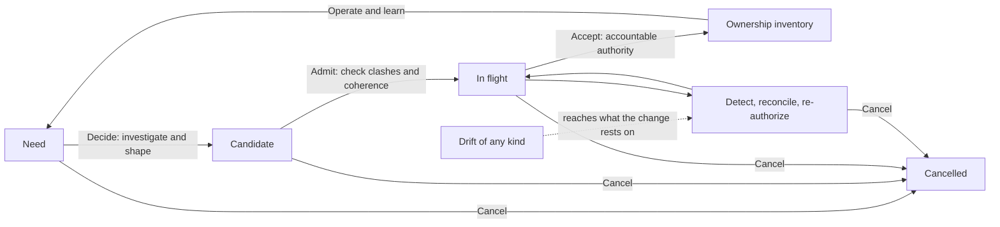

## Abstract

Agentic artificial intelligence has made producing software cheap. Agents can now plan, write, test, review, document and triage software at a scale no human team can match, and an organization can start far more changes at once than it could before. What has not become cheap is owning the result. Every change still lands in one shared system that customers and the business rely on. Someone still has to decide that the change was worth making, check that it does what was intended, run it, and answer for it when it fails.

This paper argues that the scarce resource in agentic development is no longer the effort to produce a change. It is the organization's capacity to bring many concurrent changes to one settled state that it can responsibly run. When that capacity falls behind, the extra output arrives as rework, conflicting changes, outdated assumptions and code that nobody can answer for. We do not believe making each stage faster fixes this. We believe the clashes a change meets depend on how much work is in flight and how much of it overlaps, so that faster review, testing or generation moves work along and leaves the constraint where it was. Higher quality in each change, from better tools and better use of them, is part of owning software well: it shortens time in flight and the rework a change leaves for later. The paper calls the shortfall in that quality the **AI error rate**. Every organization is improving that quality at its own rate, and the paper treats it as one of the factors that decide convergence.

The paper builds a vocabulary for managing this capacity, and each term exists because the problem cannot be managed without it:

- **Software ownership** is defined as an organization's continuing capacity to decide, validate, run and answer for the software it depends on. Defined that way, it can be planned and measured rather than assumed.
- The paper separates the one **accepted state** of a system, which the organization answers for, from the many **changes in flight** that propose to alter it. The risk lies in the gap between the two. Specifications, tests and policies count as changes in flight too, because they are edited concurrently and clash just as code does.
- **Drift** is anything that makes a change's picture of the system wrong after work on it began: another accepted change, a shift in the organization's own intent, or a change in the world.
- The **context-stability horizon** is how long a change can stay in flight before drift reaches the assumptions it rests on. A change accepted inside its horizon converges without rework. One accepted after it has to be reconciled first.
- **Accountable acceptance** is the point at which a person with authority takes responsibility for a change. The paper asks what acceptance has to require when agents produce most changes.

Drawing on Theory of Constraints, Lean product-development flow and database concurrency control, the paper states six beliefs about what decides whether concurrent work converges and the questions they raise, together with a preliminary list of the factors and outcomes involved and a set of measures. None of the beliefs are proven. The paper's purpose is to help engineering and business leaders see where ownership has become the constraint, and to argue that ownership is the discipline that lets agentic scale produce durable value instead of faster rework. It ends by inviting researchers and practitioners to establish software ownership as a field of research, and to test, refine or overturn the beliefs it sets out.

Keywords: software ownership; agentic AI; software engineering; Theory of Constraints; Lean; work in progress; concurrency control; software architecture; requirements volatility; testing; accountability; flow management

## 1. Introduction: the problem is not code generation

The usual account of AI-assisted software development begins with a bottleneck. Humans write code slowly and agents write it quickly, so the organization must speed up review, testing and deployment to keep pace. That account assumes code generation is the only step in production whose capacity can change sharply, and the assumption is wrong.

Agents can be applied to nearly every stage of the lifecycle. They draft requirements, generate design alternatives, retrieve and summarize context, implement changes, review diffs, write and execute tests, scan dependencies, propose security fixes, prepare releases, triage incidents and maintain operational artifacts. The useful contrast is between **isolated elastic execution** and the organizational work of producing a result that is coherent, valuable and accountable.

Elastic does not mean infinite. Models, compute, tool access, budgets, data, environments and orchestration all impose limits. The term means a team can expand local capacity quickly and in parallel, compared with how fast people used to do the same task. An organization can start or advance far more candidate changes than before, and it can produce far more reviews, tests, plans, tickets, instructions, documents and proposed fixes.

None of that settles whether the changes are worth making, compatible with one another, correctly understood, safe to release, or still relevant by the time they finish.

The central claim of this paper follows.

> Agentic AI can make local production capacity elastic across the software lifecycle. It does not make intent, coherence, current context, validation, operational learning or accountable acceptance elastic in the same way.

What elastic execution changes most is concurrency. When starting work is cheap, many more changes are in flight at once, and every one of them acts on the same system. They read the same code, interfaces, data, policies and decisions, and many of them propose to change the same parts. Two such changes can each be correct alone and wrong together. A change can be built on a state of the system that another change has already replaced. The decisive constraint in an agentic software organization therefore cannot be assumed to be coding, review, testing or any other named stage. It is the organization's capacity to bring concurrent, consequential changes to one settled state that it can responsibly run. This paper calls that capacity **convergence capacity**, and the organizational capacity that holds it **software ownership**.

A second kind of progress runs alongside this one: the quality of each change, meaning how well tools, and the people who instrument and direct them, serve the system's long-term interest as well as the task in hand. Excellence here is part of owning software well. It shortens the time each change spends in flight and cuts the rework it leaves for later. This paper names the shortfall the **AI error rate**: the share of changes that are wrong as produced, judged against the snapshot they were built on. Some of these errors are caught before acceptance and cost rework in flight. Others pass acceptance because they work in the short term, and surface later as defects or as locally sound changes that erode the architecture (Section 4.4). The error rate depends on the tools and on how well each organization instruments and directs them. It is falling, faster where that instrumentation is better. Section 8 sets out why we believe a falling error rate does not remove the constraint: changes that are each correct still clash with one another. Each gain also lowers the cost of starting a change, and so raises the work in flight this paper is about.

The paper makes seven contributions.

1. A definition of software ownership as an organizational capacity, limited by the principle that ownership follows intent and liability (Section 2).
2. A model of three inventories in which one accepted state, the ownership inventory, is transformed by many concurrent proposals, and a placement of each kind of artifact within it (Section 5).
3. An explanation of why per-change controls such as review, testing and specification leave the constraint in place: each validates a change against its own snapshot, not against concurrent work or the moving accepted state (Section 6).
4. A definition of drift, three freshness relations, and the context-stability horizon, with the condition under which a change converges without rework (Section 7).
5. Six beliefs about what decides whether concurrent work converges, with the open questions they raise set out in Section 13, backed by a preliminary reading of factors, outcomes and their relationships and by one candidate formalisation; and an adaptation of Theory of Constraints to shared-state dependency (Sections 8 and 10, Appendices H and L).
6. A candidate specification of what a person needs for acceptance to be accountable rather than ritual (Section 9).
7. An invitation to establish software ownership as a field of research, with the questions it starts from and the methods that could answer them (Section 13).

## 2. Software ownership: a proposed definition

This paper uses **software ownership** in a broader sense than authorship, repository permissions or the empirical idea of code ownership studied in the literature (Appendix B). A person may author a line of code, a team may own a service, and a company may own intellectual property. Each matters, and none is enough for the problem agentic production creates.

> Software ownership is a company's continuing capacity to decide, validate, run and answer for the software it depends on.

Ownership is a property of an organization, held through people, roles, records, operating practices and technical systems. It includes human judgment, but it does not require a person to inspect every generated token or perform every routine check, and automation is essential to it. What ownership demands of automation is that it serve an organization that keeps the legitimate authority to decide why a change exists, which trade-offs are acceptable, what evidence is enough, and who will answer when deployed behavior harms customers, breaks a commitment or fails under real conditions.

That authority cannot pass to a machine, and the reason is structural rather than a judgment about how capable machines are. **Ownership follows intent and liability.** Intent is the answer to why the software exists at all: which customers it serves, which obligations it meets, which risks the organization will carry for it. Liability is the duty to bear the consequences when it fails. A tool holds neither. It has no purpose of its own for the software, and it bears no consequence when the software harms someone. Ownership could move only if intent and liability moved together to the same party. When that happens in practice, as when a vendor contracts to run a system and to carry the liability for it, ownership moves to the vendor, which is another organization of accountable people, and not to the vendor's tools. Ownership can move between organizations. It cannot move to a machine. Automation can make the people who hold ownership far more capable; it does not replace them.

Throughout, this paper separates two systems that the word "system" can blur. The **owned system** is the software itself, with its code, configuration, data, dependencies and operational behavior. The **production system** is the organization that changes and runs it: its people, agents, tools, queues, decisions and practices. Flow concepts such as work in progress, arrival rate and throughput describe the production system. Coupling, footprint and architecture describe the owned system. Appendix K defines these and the paper's other terms.

## 3. Related work

Appendix B reviews five bodies of work this paper draws on: code ownership, parallel development and conflicts, flow, concurrency control and scalability, and human oversight of automation.

Each body of work addresses part of the problem. Conflict research addresses parallel change in code. Flow research addresses work in process and constraints, mostly for work that does not alter a shared artifact. Concurrency control addresses shared state with known read and write sets. Oversight research addresses the human role in automated systems. This paper joins them into one account of what an organization must do to own software when the number of changes in flight is no longer limited by human labor.

## 4. Flow without the factory

Theory of Constraints and Lean are the most developed account of how work flows through a production system, and agentic development makes software production look more like one. This section takes what holds from them and sets aside what does not. Factory parts wait in line for one another, while software changes interfere with one another, and that difference shapes everything the paper goes on to argue.

### 4.1 What to take from Theory of Constraints and Lean

The lesson worth taking from Theory of Constraints and Lean is that local activity is not system progress. A factory can keep every worker and machine busy while orders run late and inventory grows. A software organization can do the same: generate more code, complete more automated reviews, execute more tests and open more work items, and deliver no more lasting value to customers.

### 4.2 Precedence dependency and shared-state dependency

The analogy between a factory and a software factory has a limit, and the limit is the kind of dependency between units of work.

In manufacturing, the dependencies are mostly **precedence dependencies**. A bill of materials and a routing say which parts must exist before which assemblies can be built, and in what order operations run. A late sub-assembly delays the assembly that needs it. The units themselves do not interfere with one another: building one gearbox does not change the design of the gearbox next to it.

In software, the main dependency is **shared-state dependency**. Software changes are not interchangeable parts moving through stations. Each change reads a shared, evolving system of code, interfaces, data, infrastructure, policy, operational behavior and decisions, and proposes to alter part of it. Two changes interfere when one alters something the other reads or alters. They need not be in sequence to clash; they clash because they act on the same system at the same time. A change can alter the meaning of another already in progress. A production incident can change release criteria overnight. A product decision can invalidate an architectural assumption. Software flow looks less like an assembly line than a set of concurrent transactions against one shared state.

That difference changes what flow management has to do. A factory manages queues in front of stations. A software organization also has to manage interference between the units in its queues, and interference grows with the number of units in flight, not only with their arrival rate.

### 4.3 Throughput

The right unit of throughput is therefore neither lines of code, agent tasks, pull requests, test cases nor deployments. This paper defines it as follows.

> Throughput is the rate at which the organization delivers changes that create intended value, are adequately evidenced and integrated, remain operable in production, and have been accepted by an accountable authority.

The definition does not require every release to be perfect or every risk removed. It requires that the residual risk be visible, and accepted by whoever is authorized to make that trade-off.

### 4.4 Architecture sets how much concurrency a system can absorb

This paper offers an explanation for the second finding. If interference is the mechanism that turns work in progress into rework, then how much work a team can carry depends on how often its changes overlap, and that depends on the architecture of the owned system and on the mix of changes arriving. A well-partitioned system lets many changes proceed without touching each other's assumptions; a system whose changes all pass through one schema, one shared library or one specification cannot. No universal limit on work in progress exists because sustainable concurrency is a property of each system's architecture and change mix.

This matters for agentic development. Each change an agent makes can either preserve the system's modularity, improve it, or erode it. An agent asked to complete one change takes the shortest path to that change, and the shortest path often crosses a boundary that a person who understood the architecture would have kept. A stream of locally reasonable agentic changes can do both. The cost does not appear in any single change. It appears as a falling ceiling on how many changes the system can absorb at once, which is to say as lower future throughput.

### 4.5 A limited analogy from concurrency control

Database concurrency control offers a precise vocabulary for shared-state dependency, and this paper uses it as a limited analogy. Appendix C sets out the full mapping, and what the Universal Scalability Law adds to it.

The analogy has a clear limit. A database knows each transaction's read and write sets exactly. Software does not. A change's footprint can be estimated from the code it touches, but much of what it rests on is implicit: an assumption about how a customer uses a feature, a decision recorded only in a meeting, a performance budget nobody wrote down. That is why detecting a clash between software changes is the hard part, and why Section 7 treats detection as the first problem of freshness.

### 4.6 Small batches

The Lean idea that carries over best to this problem is the small batch. Dividing a change into smaller changes before work starts has three effects in a shared-state system.

1. It shrinks each change's footprint, so fewer other changes overlap it.
2. It shortens each change's time in flight, so less drift reaches it before acceptance.
3. It converts a hidden clash into an explicit sequence. When a large change is split into parts that must land in order, the dependency between the parts becomes a precedence dependency, which flow methods handle well.

Splitting has costs. Every part must leave the accepted state coherent, so deciding how to split it needs design judgment. More parts mean more integration and acceptance events, each carrying its own overhead, so batch size trades the number of jobs against the overhead each job carries. Agentic production moves that trade-off. Agents lower the overhead of each small change, while the cost of holding a large change in flight, measured in drift and rework, rises with the number of other changes in flight. Both shifts favor smaller batches, up to the limit set by the cost of accountable acceptance for each.

## 5. Three inventories in agentic software production

Software has no warehouse of unfinished widgets, and borrowing the word *inventory* can mislead. Code costs almost nothing to copy or store. Its cost lies in the attention, integration, evidence, rework, operational exposure and future understanding needed to turn a change into a durable outcome, and to keep owning the system afterward.

This paper distinguishes three related inventories: one accepted state, and two kinds of proposal to change it.

### 5.1 Software change work in progress

**Software change WIP** is committed work that has started and has not yet become a validated, accepted and sustainably operable outcome. It includes active agent tasks, branches, generated diffs, pull requests, generated tests waiting for interpretation, incomplete migrations, behavior behind feature flags, release candidates and open follow-up actions.

A backlog item need not be change WIP. An idea may be held deliberately as an option, and it becomes WIP once the organization commits attention or agent capacity to building, validating or integrating it. The distinction matters because an unstarted option usually costs far less to carry than a half-built change that interacts with others.

### 5.2 Control-knowledge work in progress

Every change carries designed intent ahead of its implementation: the proposed requirement, the plan, the design, the new architecture rule, the revised policy, the changed test expectation, the edited agent instruction. **Control-knowledge WIP** is this proposed governing knowledge that has not yet been accepted. It also includes changes to governance that stand on their own, such as a new security policy or a revised agent skill still being drafted.

These artifacts are essential. Specification-driven development, for example, carries requirements explicitly through a specification, a technical plan, tasks, implementation and convergence [3]. Structured instructions and rules reduce ambiguity, encode lessons and make work more repeatable.

The cost of control-knowledge WIP is the same cost as change WIP, one level up. Each proposed design is built against a snapshot of the accepted designs, and each may clash with another design in progress for the same part of the system. Two teams, or two agents, can each produce a sound plan for the same module, and the plans can be incompatible. A proposed change to a widely read artifact clashes with more than its neighbors. Every change in flight that read the old version of a security policy, an architecture rule or an agent skill is built on an assumption the new version withdraws. Changes to governing knowledge therefore have the largest read-set reach of any change, and deserve the most care at admission.

### 5.3 Ownership inventory: the one accepted state

**Ownership inventory** is the accepted state of the owned system together with the continuing obligation to keep enough understanding, evidence, operational visibility and accountable authority to change and run it safely. It includes deployed code, configuration, data contracts, dependencies, relationships between services, operational commitments, the accepted specifications, architecture, policies and tests, and the decision history needed to make sense of all of them.

Three properties distinguish it from the two kinds of WIP.

It is **singular**. There is one accepted state at any moment, as a repository has one main line against many branches. Change WIP and control-knowledge WIP are many proposed transformations of it, each built against a snapshot taken when the work began. Running more than one version at once does not break this: canary deployments, feature flags and several supported releases are all described by the one accepted record, which says which versions run where.

It is **append-only, not immutable**. Each accepted version is fixed once recorded, and the accepted state moves forward only through acceptance. The history is one sequence.

It is the **reference for every other copy**. Every change in flight is fresh or stale relative to the current accepted state, and every change must in the end be reconciled with that state rather than with the snapshot it began from.

One accepted state does not mean one change at a time. It means **serialized acceptance**: changes whose footprints overlap must be placed in an order, while changes whose footprints do not overlap can proceed and be accepted fully in parallel. Databases sustain very high concurrency against one committed state on this principle. The amount of parallelism a software organization can sustain is therefore governed by how often footprints overlap, which returns to the architecture argument of Section 4.4.

Ownership inventory is "no defect", since a working product is meant to last. Its size and how tightly its parts connect, though, set the future cost of change. The further the software has outgrown any one person's understanding, the more the organization depends on shared means of reconstructing intent, tracing dependencies, assessing impact and finding who has authority to decide.

### 5.4 Where each artifact sits

The model places every governing artifact in one of two states: accepted, and therefore part of the ownership inventory, or proposed, and therefore WIP.

| Artifact | Accepted: ownership inventory (one version) | Proposed: WIP (many versions) |
| --- | --- | --- |
| Code and configuration | The main line and what is deployed from it | Branches, diffs, pull requests (change WIP) |
| Specifications and requirements | The accepted specification | Proposed edits, plans and task breakdowns (control-knowledge WIP) |
| Architecture and design | Accepted architecture rules and decision records | Proposed designs and decisions (control-knowledge WIP) |
| Tests | The accepted suite, which encodes the accepted expectations | New or changed expectations (control-knowledge WIP); generated runs awaiting interpretation (change WIP) |
| Policies, agent instructions and skills | The versions currently in force | Drafts and revisions (control-knowledge WIP) |
| Runbooks and operational commitments | Current runbooks and service-level objectives | Proposed revisions (control-knowledge WIP) |
| Decision authority | Current assignments of who decides what | Proposed reassignments (control-knowledge WIP) |

The table makes one consequence plain. A specification is not a single document that many agents can safely edit at once. It has one accepted version and any number of proposed versions, and proposed versions of the same specification clash exactly as branches of the same code do. Section 6.3 develops what this means for specification-driven development.

The three inventories are coupled. More change WIP usually produces more control-knowledge WIP, and both add to the ownership inventory once accepted. A healthy organization does not try to eliminate any of them. It stops the two kinds of WIP from growing faster than it can keep them coherent with the accepted state and with each other.

## 6. Why per-change controls leave the constraint in place

The tempting response to elastic code generation is elastic control. If agents produce more code, deploy AI reviewers. If testing becomes the bottleneck, generate more tests and run them in parallel. If documentation goes stale, have agents refresh it. If incidents rise, put agents on triage and repair.

Each of these interventions can help. They share one limit, and it is the reason none of them removes the constraint. **Each validates a change against its own snapshot.** A review reads one diff against the rules and code its author saw. A test suite runs one branch against the expectations encoded in it. A specification governs one change against the intent it recorded. None of them, as usually run, checks a change against the other changes in flight, or against the accepted state as it will be when the change lands. In database terms, they check that each transaction is consistent with itself; they do not check that the set of transactions can be accepted together. As the number of changes in flight rises, more of the failure moves into the space between changes, where per-change controls do not look.

Some established practices do check against the moving state. Continuous integration on the main line, trunk-based development and merge queues that test the combined result before the main line advances all serialize acceptance and catch clashes that branch-level checks miss. Their limit is timing. They detect a clash at the point of acceptance, after the clashing work has been done, so the rework cost has already been incurred. They are optimistic concurrency control: correct, and expensive in proportion to how often clashes occur.

### 6.1 Review scales inspection, not judgment

An AI review system can inspect thousands of diffs, apply formatting and policy rules consistently, flag dependency changes and retrieve relevant context faster than a person. That raises the capacity to inspect artifacts. It does not establish that the rules being applied are complete, current, consistent with each other or right for the trade-off at hand.

A review can be locally correct and globally wrong. Two changes can each satisfy every local rule and still conflict through a rule nobody wrote down. A change can conform to a policy that a production incident, a regulatory reading or a business decision has since made obsolete, or to a policy that another change in flight is about to revise. Model intelligence is only part of the problem; the larger part is that the reviewer judges against one snapshot, when the question that matters is how the change will interact with everything else about to be accepted.

### 6.2 Testing: what each level can and cannot show

"Testing" covers several activities with different reach, and the claim that more tests do not amount to ownership has to be made level by level. Appendix D sets out what each level can show, and against which state.

Interference between concurrent changes appears at the integration, system and journey levels, and only when those tests run against the state the changes will actually join. Two changes can each pass every unit test and their own end-to-end tests, and still break the same customer journey together. The volume of tests per change says little about this. What matters is whether the tests that can see interference run against the right state, early enough to act on the result.

How much testing a change needs is a question of risk, not of volume. In the terms of this paper, the depth of validation a change needs grows with its blast radius, the consequence of its failure, and how uncertain the organization is about what correct behavior is. Who decides the acceptable residual risk is not a testing question. It belongs to the accountable authority for that part of the system (Section 9). Testing supplies the evidence; acceptance decides whether the evidence is enough.

### 6.3 Specification-driven development moves the concurrency problem into the specification

Appendix E describes what specification-driven development does well.

Specification-driven development does not change the flow problem, and Section 5.4 shows why. The accepted specification is part of the ownership inventory and has one version. Every proposed change to it is control-knowledge WIP. When many agents or teams work from the specification at once, each proposes edits against its own snapshot of it, and the proposed edits clash exactly as concurrent code changes do. A specification edited in parallel by a thousand agents is not a single source of truth; it is a thousand uncommitted transactions against one. Specification-driven development therefore moves the concurrency problem from code into the specification. That move can be valuable, because a clash found in a plan is cheaper than a clash found in code, but only if the organization detects and orders clashing specification changes before implementation starts.

### 6.4 The control stack is itself a coupled system

The organization uses code, tests, policies, documentation, tools and agents to govern code, and those governing assets are themselves generated, changed and interpreted by people and agents. Each change in flight may be revising some of them while it depends on others. As elastic capacity raises the rate of change, it raises the rate of parallel editing of the governing assets too, and every edit to a widely read asset clashes with all the work that read it.

This does not lead to an endless chain of checks on checks in which no automation helps. It means the organization needs a capability one level up: knowing which version of each governing asset is accepted, which proposed versions are in flight, what has changed since a piece of work began, and who can resolve a clash. That capability belongs to software ownership.

## 7. Drift, freshness and the context-stability horizon

Every software change rests on a snapshot of the world. When it starts, it carries assumptions about customer need, business priority, architecture, interfaces, dependencies, data, security policy, operating conditions and the changes other teams are making. Any of those can shift while the change is in progress.

### 7.1 Drift

> Drift is any divergence between a copy and the source it is meant to match, arising after the copy was taken.

A change in flight is a copy of the accepted state, extended by a proposal. The ownership inventory is a copy too: a record of what the organization believes about its system and its world. Drift is what makes either copy wrong (Appendix F separates six kinds by origin: concurrent, intent, environmental, operational, record and structural drift). Concurrent drift is the kind that elastic execution multiplies, and the one per-change controls cannot see.

### 7.2 Three freshness relations

Freshness is a relation between a copy and its source. Three relations matter for software ownership.

1. *Fidelity* is the relation between the ownership inventory and the running system and the world. The accepted record is faithful when what the organization believes about its system, its dependencies, its customers and its obligations matches what is true.
2. *Currency* is the relation between a change in flight and the current accepted state. A change is current when nothing accepted since its snapshot alters what it rests on.
3. *Visibility* is the relation between a change in flight and the other changes in flight. Other work in flight is not yet true, since it may never be accepted, so this is not freshness in the strict sense. It is early warning: knowing which proposals that overlap this one are likely to land, and when.

The relations form a hierarchy. Fidelity must hold before the other two can: a change that is perfectly current against an accepted record that is itself wrong about production is still wrong. Currency is the condition for converging without rework. Visibility is the only relation that lets an organization act before a clash rather than after it.

Restoring any of the three relations takes three steps.

1. *Detect* that the source has moved in a way that matters to the copy.
2. *Reconcile* the copy with the moved source: rebase the branch, revise the plan, regenerate the implementation, update the test, correct the record.
3. *Re-authorize* the work: the accountable authority confirms that it is still worth doing under the new conditions.

Detection is the hard step in all three relations. To know that a change in flight is affected, someone has to know what changed anywhere in the system, or in the world, since the work began, and whether that change touches what this work rests on. Because a software change's read set is mostly implicit (Section 4.5), answering takes a current model of the whole system, its code, dependencies and interfaces, joined to the record that lives outside the code: the requirements, decisions, incidents, tickets and conversations that explain why the code is as it is. Search over a repository, or retrieval from a snapshot indexed last week, cannot answer the question, because neither knows what the system looked like when the work began or which of the many changes since then matter to it.

The other two steps depend on the first. Nobody can reconcile an artifact with a change they do not know about, and no authority can re-judge a decision on conditions it has not been shown. Given detection, much follows. A system can observe that a dependency changed, tell an agent that the design decision it relies on was superseded, re-run impact analysis, regenerate a narrow implementation, surface a new incident, or route a changed requirement to the person who can decide. Reconciliation can then often be automated. Re-authorization always needs an authorized reading of purpose and acceptable risk, even when an agent gathers the evidence and proposes the options.

### 7.3 The context-stability horizon

Two periods in the life of a change need to be kept apart.

> The **exposure window** of a change is the time from the snapshot it was built against to its acceptance into the ownership inventory.

> The **context-stability horizon** of a change is the time from that snapshot to the first drift, of any kind, that alters something the change rests on.

Drift either reaches a change's assumptions before the change is accepted or it does not.

> A change converges without rework if and only if it is accepted within its context-stability horizon.

Acceptance is what makes a change visible to everyone else as part of the accepted state, so that later work takes it into account in its own assumptions. A change accepted inside its horizon has done this cleanly. A change whose horizon ends first has to be detected, reconciled and re-authorized before it can be accepted, and any work that started from it inherits the problem.

The horizon has no universal length. A small, isolated defect fix may stay valid for months. A data migration across services, a revision to security policy or an architectural change may meet drift within days or hours. The horizon depends on how fast the surrounding system changes and on how far the change's assumptions reach.

The definition is exact; applying it is not. Whether a given drift "alters something the change rests on" is a judgment about meaning, and any practical means of detecting it will err both ways. A false positive treats an unrelated change as a clash and holds work back for nothing, which costs throughput. A false negative misses a real clash, which costs rework later or a defect in production. The quality of detection therefore sets how close an organization can operate to its real limits.

### 7.4 Techniques that reduce clashes

Two questions follow from the definition. How can fewer changes be blocked from starting because they would clash, and how can changes that have started meet less drift before acceptance?

Appendix G catalogues techniques for both. Before admission, the aim is to keep clashing work from starting together. In flight, the aim is to shorten the exposure window, or to make drift visible and cheap to absorb.

## 8. What we believe about convergence

The earlier sections argue from established bodies of work. This section states what the paper believes follows from them, as six beliefs about how an organization gets the outcomes it wants from agentic production: more accountable throughput, more changes that converge without rework, and less rework. Each belief names the factors we think decide the outcome and says briefly why we hold it. Section 13 sets out the questions they raise.

None of the beliefs is proven. Section 13 invites the research that would test them. Appendix L sets out one detailed reading of the factors, outcomes and relationships behind them, and Appendix H gives one way to put part of that reading into equations.

### 8.1 States

A unit of work moves through four states, and can leave any of them by cancellation.

1. *Need.* A reason for change exists: a customer request, a field issue, an incident, a strategic objective, a regulatory obligation.
2. *Candidate.* The need has been investigated and shaped into a proposed change with a stated intent. Candidates are options, cheap to hold.
3. *In flight.* The change has passed the commitment point (Section 5.1) and is being built, validated or integrated against a snapshot of the accepted state.
4. *Accepted.* An accountable authority has accepted the change into the ownership inventory.

Moving from Need to Candidate is deciding. Moving from Candidate to In flight is admission. Moving from In flight to Accepted is acceptance. Drift that reaches a change in flight sends it through reconciliation before it can be accepted. Section 9 describes acceptance, and Appendix I describes every stage.

### 8.2 Six beliefs

1. **How much work converges depends on how much is in flight and how much of it overlaps, not on how fast each stage runs.** Changes interfere through the shared state they act on (Section 4.2), so faster review, testing or generation does not reduce the clashes between them. Past some level of work in flight, each extra change costs the others more than it adds.

2. **Architecture sets how much work in flight a system can absorb, and every accepted change raises or lowers that limit.** A well-partitioned system lets many changes run without touching one another, and a system where every change passes through one schema does not (Section 4.4). Agent capacity spent on lowering overlap does more for durable throughput than the same capacity spent on producing more changes.

3. **Small changes, accepted early, meet less drift.** A small change overlaps fewer others and spends less time in flight, so less drift reaches it (Sections 4.6 and 7.3). The limit is the overhead every acceptance carries, and accountable acceptance carries the most (Section 9).

4. **Seeing a clash early costs less than fixing it late.** Catching a clash at acceptance is correct, but by then the rework has been done (Section 6). An organization gains most by detecting drift as it happens, by showing work in flight to the work it may meet, and by keeping its record faithful to the running system (Section 7.2).

5. **Better tools raise what an organization can deliver, but they do not remove the constraint, and they invite more work.** A lower AI error rate means fewer wrong changes, but correct changes still clash with one another (Section 1). Because cheaper tools also make starting a change easier, they raise the work in flight, which the first belief says decides convergence.

6. **However good the system becomes, the accountable person remains the final constraint, so the system has to be designed to serve that person's decision.** Ownership follows intent and liability, and no tool holds either, so it cannot pass to the system (Section 2). The key design factor is the service the system gives that person: a brief they can decide from, a load they can judge, the means to stop and reverse, and feedback on how past decisions turned out (Section 9).

These six beliefs are a starting set. Appendix L lists the factors and outcomes identified so far and the relationships we believe hold between them, and neither list is complete. Testing, refining and extending them is the work Section 13 invites.

### 8.3 Admitting a change that is predicted to clash

When a candidate is predicted to overlap with work already in flight, the organization has four choices.

1. *Wait.* Hold the candidate until the overlapping work is accepted, then start it against the new state.
2. *Stack.* Build it explicitly on top of the overlapping change, as a declared sequence.
3. *Split.* Separate the overlapping part from the rest, admit the rest now, and sequence the overlapping part.
4. *Admit and reconcile.* Start it now and accept that it will meet drift and need reconciliation.

The choice is economic. Waiting costs the delay to the value the change would deliver. Admitting a clashing change costs the expected rework. When people wrote the code, rework meant writing it again. When agents write it, regenerating an implementation is cheap, and what stays expensive is re-deciding and re-validating: establishing again that the change is still wanted, and assembling the evidence again that it is correct. Admitting and reconciling therefore becomes viable for changes whose intent and acceptance criteria are recorded well enough to regenerate from (Appendix G, item 7), and stays expensive for changes that need fresh human judgment each time they are reworked. Clash prediction is approximate, so the decision has to be revisited when a change in flight discovers that its footprint is larger than predicted.

## 9. Accountable acceptance

The last step before a change joins the ownership inventory is acceptance, and acceptance is where accountability is exercised. An organization can delegate implementation and routine enforcement widely. It cannot delegate away its commitments to customers, regulators, employees, counterparties and its own operators. Under ordinary legal and contractual arrangements an autonomous tool does not become the responsible party (Section 2). The organization and the people it designates keep the obligation to decide and to answer. A person placed solely at the point of acceptance does not make acceptance accountable. Research on automation shows why: it leaves people with the hardest parts of a task while removing the practice that keeps them able to do those parts [5], and people over-rely on automated aids in ways that training and instructions do not prevent [6]. A person approving a stream of agent-produced changes, each presented as passing every check, is in exactly that position, and their approval is a ritual unless the system around them is built to make it a decision.

Article 14 of the EU AI Act lists, for high-risk AI systems, what people assigned to oversight must be enabled to do: understand the system's capacities and limitations and monitor its operation, remain aware of the tendency to over-rely on its output, interpret its output correctly, decide not to use it or to override or reverse its output, and interrupt it through a stop button or similar procedure that brings it to a safe halt [7]. Software change is not, in general, within the scope of that article, but its list maps closely onto what accountable acceptance needs. What accountable acceptance requires of software change has still to be established. The following six conditions are one candidate set.

1. *Decision rights.* The person has the authority to accept, and the right to refuse without penalty. Acceptance that cannot be refused is not acceptance.
2. *A brief they can decide from.* The person sees, in a bounded form, the change's intent, its footprint and blast radius, what changed in the system while it was in flight, the evidence for it and the gaps in that evidence, and the residual risk they are being asked to accept.
3. *A decision load within human limits.* The volume of acceptances each person faces is kept within what they can judge. Changes below an explicit delegation boundary are accepted by automated policy, so that only consequential decisions reach people.
4. *A recorded decision, traceable to a person.* Who accepted what, on which evidence, is recorded, so that the decision can be reconstructed and answered for.
5. *The means to stop and reverse.* The person can halt a release, roll it back or disable it, and the system is built so that doing so is safe.
6. *Feedback on past decisions.* The person sees how the changes they accepted behaved in production, so that their judgment stays accurate.

Conditions like these are how ownership is instrumented. Each of them can be supported by automation; none of them can be performed by it. The sixth belief of Section 8 says why they matter more as agents improve: the accountable person is the one constraint automation cannot remove, so the interface provided towards that person is the most critical design factor for the total system.  Software and software production systems exist to serve humans first, machines second.

Appendix I describes the stages of deciding, admitting, converging and operating, and the constraint that binds at each.

## 10. Flow management under shared-state dependency

Theory of Constraints directs attention to the one part of a system that limits its throughput [8]. In a factory, that part is a station: a machine or work centre whose capacity is lower than the demand on it. Under shared-state dependency, the constraint is usually somewhere else. It is a **hot region of the owned system**, such as a core module, a central schema, a shared library or a widely read specification, through which many changes must pass and in which they collide, together with the decision capacity that governs that region. The five focusing steps still apply, read in these terms.

1. *Identify the constraint.* Find the regions where changes most often overlap, wait on one another or are reworked. The history of which parts of the system change together, and of where rework and reverted changes cluster, points to them. Also find whether the binding limit is the decision capacity over a region: the few people who can accept changes to it. Do not assume the constraint is review.
2. *Exploit the constraint.* A hot region can accept only a limited number of changes in a given period. Spend that capacity on the most valuable changes, sequence them so that each lands on the state the next expects, and make sure each arrives with its evidence, current context and a named path to a decision.
3. *Subordinate admission to the constraint.* Do not use elastic generation to start more work in a hot region than it can accept. Admission elsewhere can run freely where footprints do not overlap; admission into the hot region follows its capacity.
4. *Elevate the constraint.* Modularize the hot region so that fewer changes have to pass through it: separate its concerns, put stable contracts at its boundaries, split shared schemas and libraries. In a factory, elevating a constraint means capital, hiring and time, and comes last for that reason. In agentic production, refactoring is one of the things agents make cheap, and widening a hot region lowers overlap for every future change. The capacity that floods the system with starts can be turned to raising what can finish, and this step deserves more weight than its place in the sequence suggests.
5. *Repeat.* Relieving one region exposes the next. The aim is continuing management of a system that keeps changing, and a pipeline built once cannot meet it.

Where limits on starts are needed, they should be weighted by overlap rather than counted. A useful policy weights each change by its blast radius, the centrality of the parts it touches, how hard it is to undo, the sensitivity of its data, its security or regulatory consequence, the uncertainty of its validation, and how fast its surrounding context changes. The point is to make visible that different changes draw different amounts of shared ownership capacity, and no universal score needs to come out of it.

How critical a change is belongs here too. A change does not become critical because an agent can produce it quickly or because work has already gone into it. It is critical when it carries high expected value or obligation, has a defensible path to convergence, and outranks competing claims on scarce ownership capacity. An obsolete or weakly evidenced change should be stopped early even when it is nearly complete, since sunk implementation effort is no reason to keep it in flight.

Each of these steps needs people with authority over the region, supported by systems that show them overlap, drift and the state of work in flight.

## 11. Measures that reflect durable throughput

A production system turns dangerous when it measures what is easiest to count instead of what it needs to optimize. In agentic environments, lines generated, agent runs, pull requests opened, test cases executed, reviews completed and deployments started are all useful operational signals, and none measures durable value directly.

A measurement system for software ownership should ask seven questions. Appendix J gives each in full.

1. How much work is in flight, and how long is it exposed?
2. How much does the work in flight overlap? The first belief of Section 8 holds that this quantity matters most, and it is rarely measured.
3. How much rework is the system creating, and how much of it comes from each kind of drift and how much from the AI error rate?
4. How quickly is drift detected?
5. Can the organization explain and accept what it ships?
6. Is the architecture holding?
7. Does delivered software create durable outcomes?

These measures exist to improve the system, never to rank individuals or punish teams. Used that way, they would recreate the failure of local efficiency that Theory of Constraints and Lean warn against, in which people optimize visible activity while the real constraint and the accumulated inventory stay hidden.

## 12. What this paper rejects

The theory rejects four conclusions that are sometimes drawn from arguments like it.

AI should not be slowed down to preserve a human-centered workflow. The objective is higher sustainable throughput, and automation can raise it sharply when it reduces overlap, shortens exposure, improves evidence and strengthens operational learning. Section 10 puts agents to work on elevating the constraint for exactly this reason.

Nor does every change need exhaustive specification up front. Where things change fast, premature specification turns into stale inventory of its own. What the model asks for is intent and evidence that are sufficient, current and in proportion to risk, and revised as the world changes.

A human need not personally approve every low-risk action either. Routine decisions and controls can be delegated, provided the boundary of delegation, the evidence, the path for exceptions and the accountable authority are explicit.

Last, no tool owns software. Ownership follows intent and liability, and a tool holds neither (Section 2). The capacity to decide, converge, operate and answer remains with the organization and the people it makes accountable. That has been true of every earlier generation of software tooling, and agentic tooling does not change it.

## 13. Software ownership as a field of research

This paper does not settle the questions it raises. It proposes that software ownership be studied as a discipline in its own right, whose object is an organization's capacity to decide, converge, run and answer for the software it depends on, and it invites researchers and practitioners to take up that study.

The six beliefs of Section 8 give the field its first questions.

1. How much overlap can a given system carry before more work in flight lowers what it delivers?
2. Can the erosion of a system's architectural limit on concurrency be measured before it shows up as lost throughput?
3. At what size does the overhead of each acceptance outweigh the drift a smaller change avoids?
4. How accurately can a clash be predicted from what is known about a change before work on it starts?
5. Does a falling error rate raise durable throughput, or mostly the amount of work in flight?
6. What must a decision brief contain, and how many consequential decisions can a person make well in a day?

The field needs two things before it can answer them: a shared vocabulary and agreed measures. The paper's terms, from the accepted state and work in flight to overlap, drift, the context-stability horizon and accountable acceptance, are a proposal for the first. Section 11 and Appendix J sketch the second. Overlap matters most and is measured least, and until it is measured the first belief can be argued but not tested.

Several kinds of study could then test the beliefs.

1. *Simulation.* Model a flow of changes against a shared state, vary work in flight, overlap, drift and error rates, and see whether delivered throughput rises, peaks and falls as the first belief expects. Appendix H gives one starting formalisation.
2. *Mining change histories.* Repositories, review systems and incident records hold which parts of a system changed together, which changes were reworked or reverted, and how long each was in flight. Co-change gives a proxy for overlap, and the histories can show whether rework rises with work in flight and overlap together.
3. *Controlled experiments with agent teams.* Agents make it cheap to run the same body of work many times under different conditions: more or less work in flight, different batch sizes, different admission policies, different architectures of the same system. Experiments like these were rarely practical at scale with human teams.
4. *Field studies of acceptance.* Observe the people who accept changes, the load they carry, what they are shown and how their decisions turn out in production, to test the sixth belief and the conditions of Section 9.
5. *Design research.* Build and evaluate the tools the beliefs call for: clash prediction before admission, drift detection in flight, and decision briefs for accountable people.

The work draws on code ownership, parallel development, flow, concurrency control and human oversight of automation (Appendix B), and it needs people from each of them, working with the people who run software organizations. Some of the beliefs may prove wrong. The questions need answers now, while organizations are deciding how to use agents, and answering them will take researchers and practitioners working together.

## 14. Conclusion

Agentic AI changes the economics of software production. Candidate code, and many of the artifacts around it, can now be produced at a speed and scale no human-only organization could approach, and the same may soon hold for review, testing, documentation, operations and governance. Searching for the one downstream stage that agents have not yet accelerated is therefore the wrong response.

What elastic execution changes most is concurrency. Many more changes are in flight at once, and every one of them acts on one shared, accepted state. They collide with one another, outlive the assumptions they were built on, meet drift from the organization's own changing intent and from the world outside, and cost more to reconcile than to stop. We believe the clashes between them depend on how much work is in flight and how much it overlaps, not on how fast any stage runs, and that this is why faster review and testing leave the constraint in place. Architecture sets how much concurrency a system can absorb, and every accepted change either preserves that capacity or erodes it.

Software ownership is the organizational capacity that makes convergence possible. It decides which changes are worth making, admits them so that overlapping work is ordered and separate work runs freely, keeps the accepted state faithful and the work in flight current, automates what can be automated, manages the active constraint, and keeps accountable authority over what enters the accepted state.

The question this framing asks is whether an organization can produce more **durable value per unit of consequential change**, and whether an AI system can produce more software is beside the point. We expect the organizations that succeed to be the ones that use agents to raise convergence capacity, by lowering overlap, shortening exposure and making acceptance accountable, faster than they raise the volume of work in flight. Maximizing agent activity will not get them there. However good the system becomes, the people who answer for the software remain its final constraint, and the best systems will be the ones designed to serve their decisions.

These are beliefs, not findings. Section 13 sets out the questions they raise and the ways they could be tested, and invites others to establish software ownership as a field of research that answers them.

## Appendix A. The eighteen jobs of software ownership

The eighteen jobs give the capacity its scope. They are named, not exhaustive: a representative set of the established activities that owning software involves, each an established part of software engineering as the field's body of knowledge describes it [9], or a category of software maintenance as the international standard defines it [10]. Other activities, such as capacity planning, cost management or data stewardship, belong to the same capacity, and an organization's own list will differ in its detail. Writing new code is not in the table: it would be a nineteenth job, and is one among many in practice.

| # | Job | Established term and source |
| --- | --- | --- |
| 1 | Requirements | Software requirements [9] |
| 2 | Architecture | Software architecture [9] |
| 3 | System design | Software design [9] |
| 4 | Code review | Software quality [9] |
| 5 | Testing | Software testing [9] |
| 6 | Release and deployment | Software engineering operations [9] |
| 7 | Observability | Software engineering operations [9] |
| 8 | Incident response | Software engineering operations [9] |
| 9 | Debugging | Corrective maintenance [10] |
| 10 | Root cause analysis | Corrective maintenance [10] |
| 11 | Refactoring | Perfective maintenance [10] |
| 12 | Performance tuning | Perfective maintenance [10] |
| 13 | Dependency upgrades | Adaptive maintenance [10] |
| 14 | Migrations | Adaptive maintenance [10] |
| 15 | Security patching | Software security [9]; preventive maintenance [10] |
| 16 | Tech debt | Preventive maintenance [10] |
| 17 | Configuration management | Software configuration management [9] |
| 18 | Onboarding | Software engineering professional practice [9] |

## Appendix B. Related work

### B.1 Code ownership

Empirical work on code ownership measures how the contributions to a component are distributed among developers. Bird and colleagues found, on Windows Vista and Windows 7, that ownership measures such as the number of minor contributors and the share of changes made by the top contributor were related to pre-release faults and post-release failures [11]. A replication across four further Microsoft products confirmed the relation at file and directory level [12]. That literature treats ownership as a property of authorship and asks whether concentrated authorship improves quality. This paper uses the word for something wider: the organizational capacity to decide, validate, run and answer for software, which can be intact when no individual wrote most of the code, and absent when one individual wrote all of it.

### B.2 Parallel development and conflicts

Parallel change is a long-standing subject in software engineering research. Perry, Siy and Votta studied the change history of a large legacy system to understand the problems of parallel development [13]. Brun and colleagues studied nine open-source systems and found that conflicts between developers' copies of a shared project were frequent and persistent, and that they appeared not only as overlapping textual edits but as later build and test failures; their tool, Crystal, detects such conflicts early through speculative analysis of version-control operations [14]. Sarma, Redmiles and van der Hoek's Palantír gives developers awareness of relevant parallel changes in other workspaces, and their experiments found earlier detection and resolution of more conflicts [15]. Kasi and Sarma's Cassandra goes a step further: it identifies likely conflicts before work starts, expresses them as constraints, and proposes task schedules that minimize them [16].

This paper builds on that work in two ways. It treats conflict between changes as the central mechanism of software flow rather than as one problem among many, and it extends the notion of conflict beyond source code to every artifact that governs a change: specifications, decisions, policies, tests and agent instructions.

### B.3 Flow: Theory of Constraints, Lean and product-development flow

Goldratt's Theory of Constraints holds that the throughput of a system is set by its constraint, and directs managers through five focusing steps: identify the constraint, exploit it, subordinate everything else to it, elevate it, and repeat when the constraint moves [8]. Gupta and Boyd argue that the theory can serve as a general theory of operations management, chiefly because it avoids the pitfalls of local optimization, while noting that it has mostly not been tested empirically [17]. Lean production, as Ohno described it at Toyota, stresses flow, the removal of waste and production pulled by demand [18].

Both bodies of work were built for repetitive physical production. Reinertsen adapted flow thinking to product development, where work is not repetitive, and argued that unmanaged queues are the main cause of poor product-development performance, that queue size is a leading indicator where cycle time trails, and that batch size is an economic trade-off between holding cost and transaction cost rather than a quantity to minimize at any cost [19]. Kanban, as Anderson and Carmichael describe it, balances the demand for work against the capacity to start it, and marks the point at which an item is committed to [20]. DORA, the DevOps Research and Assessment program, applies limits on work in process to technology work [1], and Forsgren, Humble and Kim found that high delivery performance is possible with all kinds of systems provided the systems, and the teams that build them, are loosely coupled [21].

### B.4 Concurrency control and scalability

Database research solved a version of the problem this paper addresses. Many transactions read and write one shared state concurrently, and the database must make the result equivalent to some order of them. Berenson and colleagues showed that the ANSI SQL definitions of isolation levels were incomplete, and defined snapshot isolation, in which each transaction works from a snapshot of the committed state [22]. Gunther's Universal Scalability Law models how the throughput of a system changes as concurrency rises, through two costs: contention for shared resources, and the coherency delay of keeping shared state consistent [23]. Section 4.5 and Appendix C use both, as a limited analogy.

### B.5 Human oversight of automation

Bainbridge's "Ironies of automation" observed that automating most of a task leaves people with the parts that cannot be automated, while depriving them of the practice they need to do those parts well [5]. Parasuraman and Manzey reviewed automation complacency and automation bias and concluded that both are overlapping, attention-driven phenomena that training and instructions do not prevent [6]. Regulation now states what effective oversight requires: Article 14 of the EU AI Act lists the capabilities a person assigned to oversee a high-risk AI system must be enabled to exercise [7]. Section 9 draws on all three.

## Appendix C. The database analogy and the Universal Scalability Law

| Database concept | Software counterpart |
| --- | --- |
| Committed state | The ownership inventory: the one accepted state of the owned system (Section 5.3) |
| Transaction | A change in flight |
| Snapshot read | The state of the system and the world a change was built against |
| Read set | Everything the change rests on: code, interfaces, data, decisions, intent, policies, tests |
| Write set | The change's footprint: everything it alters |
| Commit | Acceptance into the ownership inventory by an accountable authority |
| Pessimistic locking | Admission control: a clashing change waits before it starts |
| Optimistic validation and retry | Detecting a clash at integration and reworking the change |
| Write skew | Two changes, each correct against its snapshot, that jointly break an invariant |

The Universal Scalability Law states the consequence for throughput. Gunther models relative capacity at concurrency \(N\) as \(C(N) = N / (1 + \alpha(N-1) + \beta N(N-1))\), where \(\alpha\) is the cost of contention for shared resources and \(\beta\) the cost of keeping shared state coherent [23]. With any coherency cost, throughput rises with concurrency, peaks, and then falls. In a software organization, contention is changes waiting on the same scarce decision or the same region of the system, and coherency is the work of keeping changes in flight consistent with one another and with the accepted state. The law gives a formal reason to expect that adding concurrency past some point lowers throughput, and the argument of Section 4.4 says where that point lies: it depends on the architecture.

## Appendix D. What each level of testing can show

| Level | What it gives evidence of | Against which state | Can it see interference between changes? |
| --- | --- | --- | --- |
| Unit | A unit behaves as its author expected | The change's own snapshot | No |
| Integration | Units or services work together | The snapshot, unless run against the main line | Only when run against the accepted state with other changes included |
| System and non-functional (load, performance, security, resilience) | Properties of the whole system | An environment | Only if the environment reflects the current accepted state |
| Acceptance and end-to-end | Customer journeys meet intent | Usually a shared environment | Yes, where changes touch the same journey |
| Verification in production (canary release, observability) | Real behavior under real use | The running system | Yes, but after the change is live |

The lower levels give evidence about a change in isolation, and that is where agents generate most tests.

## Appendix E. Specification-driven development

Specification-driven development is best read as an answer to ambiguity and traceability, and not as a way to make intent permanently complete. It moves important work earlier: stating what and why before how, writing plans and tasks, and using them to guide implementation [3]. Done well, it can reduce rework and make changes easier to review.

Specifications also drift from the world. Requirements volatility is ordinary. A survey-based empirical study found that it significantly affects schedule and cost overruns, and traced it to changing conditions among stakeholders and within organizations [24].

## Appendix F. Six kinds of drift

| Kind | Origin | What it breaks (Section 7.2) |
| --- | --- | --- |
| Concurrent drift | Another change is accepted and alters something a change in flight rests on | Currency |
| Intent drift | The organization's own purpose, priorities or stakeholders change | Currency of the decision behind the change |
| Environmental drift | The world outside changes: customers, market, regulation, third-party dependencies and interfaces, threats | Fidelity, then the currency of dependent work |
| Operational drift | The running system departs from the accepted record without an accepted change: configuration drift, emergency fixes, shifts in data, infrastructure changes, changed behavior of embedded AI models | Fidelity |
| Record drift | The written and remembered record departs from the accepted system: stale specifications and decision records, inconsistent comments, understanding lost when people leave | Fidelity within the inventory |
| Structural drift | Accepted changes, each acceptable alone, erode the intended architecture [25] | No relation directly; it raises overlap between future changes and lowers the ceiling on concurrency |

Concurrent drift is the kind that elastic execution multiplies, and the one per-change controls cannot see. Intent drift is the kind requirements research has long measured [24]. Record drift has empirical support at the simplest level: a study that mined 1.3 billion AST-level changes from the complete history of 1,500 systems found that keeping code comments consistent with the code they describe takes substantial ongoing effort [26]. Comments are only the simplest record, and this paper does not claim that every specification or agent instruction drifts at the same rate; the point is that no record maintains itself because it is written down, stored in a repository or handed to an agent. Structural drift is different in kind from the rest. It makes no single change stale, but it lowers the amount of concurrency the system can absorb in future (Section 4.4).

## Appendix G. Techniques that reduce clashes

Before admission, the aim is to keep clashing work from starting together.

1. *Predict footprints.* Estimate each candidate change's read and write sets from the code, interfaces, data and decisions it will touch, and from the history of which parts of the system change together.
2. *Schedule with clashes in mind.* Choose which candidates to admit together so that their footprints do not overlap, as Cassandra does for developers' tasks [16].
3. *Split.* Divide a large change into smaller ones with smaller footprints, sequenced explicitly (Section 4.6).
4. *Accept the contract first.* Where several changes must meet at an interface, accept the interface change on its own, then let the implementations proceed in parallel against an accepted contract rather than a proposed one.

In flight, the aim is to shorten the exposure window, or to make drift visible and cheap to absorb.

1. *Keep batches small,* so that each change spends less time in flight.
2. *Accept structure early.* Commit a change to the accepted state behind a disabled flag, so that its structure becomes part of what others build on before its behavior is released.
3. *Publish intent before acceptance.* Make a change's proposed footprint and purpose visible to other work in flight, so that overlapping work learns of it while both are still cheap to adjust. This raises visibility.
4. *Stack dependent work.* Build a change explicitly on top of the in-flight change it depends on, turning a hidden clash into a declared sequence.
5. *Reconcile continually.* Absorb drift in many small reconciliations rather than one large one at the end, since the cost of reconciling grows with the distance between the copy and its source.
6. *Expand, then contract.* Make breaking changes in stages that keep both the old and the new form valid until every dependent change has moved.
7. *Regenerate from preserved intent.* Where a change has drifted, discard the implementation and regenerate it against the current accepted state from its recorded intent and acceptance criteria.

## Appendix H. A candidate formalisation of the convergence model

This appendix puts the first relationships of Appendix L into equations, as one way among several of doing so. Its quantities, including the level of work in flight at which rework-free throughput peaks and the share of changes that converge at the peak, are predictions to test rather than findings. They rest on strong assumptions, stated at the end.

| Symbol | Meaning |
| --- | --- |
| \(L\) | Changes in flight (work in progress) |
| \(\lambda\) | Rate at which changes are admitted |
| \(X\) | Rate at which changes are accepted (throughput) |
| \(X_0\) | Rate at which changes are accepted without rework (rework-free throughput) |
| \(\gamma\) | Rate at which changes in flight are cancelled |
| \(W\) | Mean exposure window |
| \(p\) | Probability that a given accepted change alters something a given change in flight rests on (overlap) |
| \(\delta\) | Rate at which drift of the other kinds reaches a given change in flight |
| \(\varepsilon\) | AI error rate: probability that a change is found wrong before acceptance, judged against its own snapshot |
| \(h\) | Context-stability horizon of a change |

### H.1 The flow balance

Counting changes, the work in flight evolves as

\[
\frac{dL}{dt} = \lambda - X - \gamma
\]

Rework does not add changes to this count. It keeps changes in flight longer, which lengthens \(W\), and it consumes capacity that would otherwise have accepted other changes, which lowers \(X\). When \(\lambda\) persistently exceeds \(X + \gamma\), work in flight grows, and by Little's Law the exposure window grows with it.

### H.2 Converging without rework

Consider one change in flight. During its exposure window, about \(XW\) other changes are accepted. Suppose each alters something this change rests on with probability \(p\), independently, and that the other kinds of drift reach it at rate \(\delta\). If both kinds of event arrive as Poisson processes, the probability that the change is accepted inside its horizon is

\[
P(h > W) \approx e^{-(Xp + \delta)W}
\]

In a stable production system Little's Law gives \(XW \approx L\) [4]: the number of changes accepted while one change is in flight is about the number in flight. A change converges without rework when it is also correct as produced. If it is found wrong before acceptance with probability \(\varepsilon\), independently of drift, then

\[
P(\text{converge without rework}) \approx (1-\varepsilon)\, e^{-(pL + \delta W)}
\]

### H.3 Where rework-free throughput peaks

Little's Law also gives \(X \approx L/W\). Multiplying by the probability above gives the rate at which changes converge without rework:

\[
X_0(L) \approx \frac{L}{W}\,(1-\varepsilon)\, e^{-(pL + \delta W)}
\]

Treat \(W\) as fixed, set by how fast each stage runs. Then \(dX_0/dL\) is proportional to \((1 - pL)\,e^{-pL}\), which is zero at \(L^*= 1/p\). Below \(L^*\), admitting more work raises rework-free throughput; above it, admitting more work lowers it. The peak value is

\[
X_0(L^*) \approx \frac{1-\varepsilon}{e\,pW}\, e^{-\delta W}
\]

and at the peak the probability of converging without rework is \((1-\varepsilon)\,e^{-1-\delta W} \le e^{-1} \approx 0.37\). Neither \(\varepsilon\) nor \(W\) appears in \(L^*\). Both change the height of the peak, and only overlap sets where it lies.

The peak is not a state free of rework. It marks the point past which admitting one more change removes more rework-free acceptances from other changes than it adds, a different limit from the runaway regime of Appendix L, where admission outpaces acceptance and cancellation altogether. Errors that pass acceptance and fail later do not enter \(\varepsilon\). They act as structural or record drift (Appendix F), and they raise \(p\) for the changes that follow.

The assumptions are strong. Overlap is not independent across changes, drift does not arrive at a constant rate, \(p\) differs from one change to the next, and \(W\) is not fixed: rework lengthens it, so beyond \(L^*\) the fall is steeper than the expression shows. The expressions are illustrative. Whether real systems show their shape is one of the questions Section 13 invites research to answer.

## Appendix I. The stages of an owned change

### I.1 Decide: from need to candidate

Software exists to serve a purpose. The organization has to decide which customer need, risk, contractual obligation, strategic objective or operational requirement justifies a change. Some needs arrive from people deciding what should be done. Others arrive automatically: a field issue, an alert, a dependency advisory, a failed check. Every need, however it arrives, needs investigation before it becomes a candidate: discovery of what is actually wrong or wanted, why it matters, and how it is best served. A duplicated alert, a symptom of a deeper fault, or a request that conflicts with a commitment elsewhere should not become a change in flight.

Where the need is clear, low in consequence and well understood, investigation and shaping can be automated, and the candidate can enter the list without a person's judgment. Where it is not, judgment is needed in proportion to the consequence. Agents can pull evidence together and propose alternatives, but predicting likely text does not let them establish what the organization is for.

Humans need not write every requirement by hand. Someone must, however, have the authority to resolve conflicts. Should reliability work outrank a feature? Should a compatibility break be accepted? Should an incident change the release plan? Should an attractive request be stopped? These are decisions about value and responsibility, and no transformation of existing artifacts settles them. Intent drift (Appendix F) enters the model here: when the reason for a change moves, every candidate and every change in flight built on the old reason is affected.

### I.2 Admit: from candidate to in flight

Admission decides which candidates start, and when. Its constraint is coherence. Software changes are coupled through APIs, schemas, shared libraries, data semantics, identity boundaries, performance budgets, infrastructure and operational practice. More parallelism creates more room for useful work, and also more interactions that someone must discover, sequence or design away.

The organization therefore needs architecture as a current, usable basis for deciding what can change independently, what must be coordinated and what has a wide blast radius; a static diagram cannot serve. For the same reason a flat limit on work in progress fails. A small isolated change and a high-impact migration across services should not consume the same share of flow capacity, and two changes that are each small can still be unable to run together if they overlap. Admission is where the techniques of Appendix G and the economic rule of Section 8.3 apply.

### I.3 Converge: building, validating and integrating against a moving state

While a change is in flight, its constraints are currency and validation. A change is correct relative to a particular state of requirements, code, policy, dependencies and operations. The constraint is the ability to keep consequential work current until it is accepted, which, as Section 7.2 argued, depends first on detecting drift.

Validation in this stage has to answer how much evidence the change needs and against what state, as Section 6.2 and Appendix D set out. Integration means more than resolving merge conflicts. It reconciles assumptions across releases, services, configuration, data, behavior under load and modes of failure.

### I.4 Operate and learn: from accepted state back to need

Production supplies evidence that no stage before release can fully supply. Operational drift (Appendix F) appears here, as does much of environmental drift. Ownership needs a feedback loop from operations into fidelity, so that the accepted record matches the running system, and into new needs, so that incidents, near misses, reliability signals, support evidence, security findings and changed customer needs shape what is decided next. This closes the loop of Section 8.1.

## Appendix J. Measures in detail

### J.1 How much work is in flight, and how long is it exposed?

Measure change WIP and control-knowledge WIP across the whole value stream, including implementation, review, validation, release, operational follow-up and the governing artifacts the work needs. Track the distribution of exposure windows, not only their average, since the longest-exposed changes are the ones most likely to meet drift.

### J.2 How much does the work in flight overlap?

Estimate overlap among changes in flight: the share of pairs whose footprints intersect, and the regions where intersections concentrate. Historical co-change, the record of which parts of the system have changed together, is one practical proxy. The first belief of Section 8 holds that overlap matters most, and it is rarely measured.

### J.3 How much rework is the system creating, and from which source?

Watch for material regeneration, rebases, reopened work, repeated review cycles, abandoned branches and reversals after release, and attribute each to the kind of drift that caused it (Appendix F). Rework is not always waste, because it can be correct adaptation. What matters is whether its rate is overwhelming the system's ability to converge, and which source is driving it. Separate rework caused by drift from rework caused by errors in the change as produced: the first falls only with less work in flight or less overlap, the second with better tools and better use of them.

### J.4 How quickly is drift detected?

For changes in flight, measure the delay between a material drift event and the moment the owner of the affected work learns of it. For the ownership inventory, measure how long the accepted record stays out of step with the running system. One candidate summary is the share of changes in flight whose assumptions moved before acceptance, and of those, the share that were reconciled and re-authorized before release.

### J.5 Can the organization explain and accept what it ships?

Measure how complete and sound the trace is from intent to change, evidence, release and operation. The standard is whether the organization can reconstruct a decision and name the accountable authority at the level of risk involved, and maximal paperwork does not meet it. Measure, too, the decision load on each accountable person, since acceptance quality depends on it (Section 9).

### J.6 Is the architecture holding?

Track coupling and the concentration of changes in hot regions over time. Rising overlap at constant work in flight is the signature of structural drift, and an early warning that the ceiling on concurrency is falling.

### J.7 Does delivered software create durable outcomes?

Combine delivery measures with reliability, security, customer impact, operational burden and the rate of rapid reversal or repair. A release that ships quickly and immediately causes incidents, churn or unplanned corrective work is no evidence of higher sustainable throughput.

## Appendix K. Glossary

| Term | Definition |
| --- | --- |
| Owned system | The software itself: code, configuration, data, dependencies and operational behavior |
| Production system | The organization that changes and runs the owned system: people, agents, tools, queues, decisions and practices |
| Software ownership | An organization's continuing capacity to decide, validate, run and answer for the software it depends on |
| Ownership inventory | The one accepted state of the owned system, with its append-only history and the obligation to keep it understood, evidenced, observed and governed |
| Software change WIP | Committed implementation work that has not yet been accepted |
| Control-knowledge WIP | Proposed changes to governing knowledge (specifications, designs, rules, policies, tests, instructions) not yet accepted |
| Commitment point | The point at which a candidate becomes work in flight |
| Footprint | Everything a change alters (its write set) |
| Assumptions | Everything a change rests on (its read set), much of it implicit |
| Overlap | The extent to which one change's footprint touches another's assumptions or footprint |
| Drift | Any divergence between a copy and the source it is meant to match, arising after the copy was taken; six kinds are distinguished by origin (Appendix F) |
| Fidelity | Freshness of the ownership inventory against the running system and the world |
| Currency | Freshness of a change in flight against the current accepted state |
| Visibility | Awareness, for a change in flight, of overlapping changes in flight |
| Exposure window | Time from a change's snapshot to its acceptance |
| Context-stability horizon | Time from a change's snapshot to the first drift that alters something it rests on |
| AI error rate | The share of changes that are wrong as produced, judged against the snapshot they were built on. The part found before acceptance is written \(\varepsilon\) (Appendix H); the part found later acts as drift (Appendix F) |
| Rework-free throughput | The rate at which changes are accepted without rework; written \(X_0\), it is believed to peak at a level of work in flight set by overlap (Appendices H and L) |
| Convergence capacity | The organization's capacity to bring concurrent, consequential changes to one accepted state it can responsibly run, or to cancel them deliberately |
| Accountable acceptance | Acceptance by an authority that meets the candidate conditions of Section 9 |

## Appendix L. One reading of cause and effect

This appendix sets out the detail behind the six beliefs of Section 8: the outcomes an organization might want from agentic production, the factors we have identified that may influence them, and the relationships we believe hold between the two. It is one possible reading, not the only one. Both lists are preliminary and representative rather than complete, and the relationships are conjectures. We offer all three for the field to test, refine and replace.

### L.1 Outcomes

| Outcome | What it captures | Where the paper discusses it |
| --- | --- | --- |
| Accountable throughput | The rate of changes that create intended value, are evidenced, integrated and operable, and have been accepted by an accountable authority | Section 4.3 |
| Convergence | The share of changes accepted inside their context-stability horizon, without rework | Section 7.3 |
| Rework | How much work is redone, and from which source | Appendix J.3 |
| Lead time and exposure | How long changes spend in flight, and the spread of that time | Section 7.3, Appendix J.1 |
| Escaped defects | Errors that pass acceptance and surface in production | Section 1, Appendix F |
| Concurrency ceiling | How much work in flight the system can absorb, which is the health of its architecture over time | Section 4.4, Appendix J.6 |
| Acceptance quality | Whether acceptance is a decision or a ritual | Section 9, Appendix J.5 |
| Durable outcomes | Reliability, security, customer impact and operational burden after release | Appendix J.7 |
| Cost of ownership | What it costs to decide, converge, run and answer for each accepted change | Section 5 |

### L.2 Factors

| Factor | Symbol | Where argued | Outcomes it is believed to move |
| --- | --- | --- | --- |
| Work in flight | \(L\) | Sections 5.1, 8 | Raises throughput up to a point, then lowers convergence and raises rework |
| Overlap, set by architecture and change mix | \(p\) | Sections 4.4, 5.3 | Higher overlap lowers convergence at any level of work in flight and lowers the concurrency ceiling |
| Stage speed and exposure window | \(W\) | Sections 6, 7.3 | A shorter window reduces drift from sources other than concurrent work, and shortens lead time |
| Drift rate, by kind | \(\delta\) | Section 7.1, Appendix F | Each kind lowers convergence; record and operational drift also erode fidelity |
| AI error rate before acceptance | \(\varepsilon\) | Section 1, Appendix H | A lower rate raises throughput and cuts rework from errors |
| Errors that pass acceptance, and structural drift | | Section 4.4, Appendix F | Raise escaped defects and future overlap, and lower the concurrency ceiling |
| Batch size and footprint | | Section 4.6 | Smaller batches lower overlap and exposure, and raise the number of acceptance events |
| Clash-detection quality | | Section 7.3 | False positives cost throughput; false negatives cost rework and escaped defects |
| Cost to reconcile and regenerate | | Section 8.3, Appendix G | Lower cost makes admitting a clashing change viable and lowers the cost of rework |
| Admission policy | | Sections 8.3, 10 | Admission that keeps overlapping work apart raises convergence and throughput |
| Acceptance decision capacity and load | | Sections 9, 10 | Load beyond human limits lowers acceptance quality and raises escaped defects |
| Read-set reach of control-knowledge WIP | | Sections 5.2, 6.3 | Edits to widely read artifacts lower convergence for every change that read them |
| Visibility of intent in flight | | Section 7.2, Appendix G | Lets clashes surface before rework rather than after |
| Fidelity of the record | | Section 7.2 | A precondition for convergence; without it, being current gains nothing |
| Arrival and admission rate | \(\lambda\) | Appendix H | Raises work in flight when it exceeds acceptance and cancellation |
| Cancellation discipline | \(\gamma\) | Sections 8.1, 10 | Stopping obsolete work early lowers work in flight and rework |
| Partition of ownership scopes and decision rights | | Sections 9, 10 | Clear scopes let separate work run freely and route each decision to someone who can make it |
| Acceptance overhead per event | | Sections 4.6, 9 | Higher overhead favours larger batches and lowers throughput |
| Tool quality and how well it is instrumented | | Section 1 | Drives the AI error rate and the cost of each change |

### L.3 Conjectured relationships

1. *Clashes scale with work in flight and overlap together.* The expected number of clashes a change meets grows with the number of other changes in flight and with the chance that each touches what it rests on, and does not depend on how fast any stage runs.
2. *Rework-free throughput peaks.* As work in flight rises, rework-free throughput rises, peaks and falls. Overlap sets where the peak lies; speed and the AI error rate set its height.
3. *Speed helps indirectly.* Faster stages reduce drift from sources other than concurrent work by shortening the exposure window. They reduce clashes between changes only by lowering work in flight, when admission is held fixed.
4. *Better tools invite more work.* A falling AI error rate raises throughput and cuts rework from errors, leaves clashes between correct changes unchanged, and raises the arrival rate by making starts cheaper.
5. *Structural drift lowers the ceiling.* Errors that pass acceptance, and locally sound changes that erode the architecture, raise overlap for future changes and lower the concurrency the system can absorb.
6. *Decision load turns acceptance into ritual.* When consequential decisions arrive faster than accountable people can judge them, acceptance quality falls and escaped defects rise.
7. *Governing artifacts reach furthest.* An edit to a widely read specification, policy or agent instruction clashes with every change in flight that read the old version.
8. *Rework can run away.* Rework lengthens the exposure window and lowers throughput. If admission continues at the same rate, work in flight rises, and with it the clashes each change meets, so the share that converges without rework falls further. This is the **non-convergent rework regime**: new work and new drift arrive faster than the organization can turn them into accepted outcomes or choose to stop them. Local agent metrics can look excellent here, with more code produced, more reviews completed, more tests run and more plans drafted, while queues lengthen, context goes stale, integrations fail, decisions are deferred and operational risk grows.
9. *Batch size trades drift against overhead.* Smaller batches lower overlap and exposure at the cost of more acceptance events. Agents lower the cost of each small change and so shift the balance toward smaller batches, up to the limit set by the cost of accountable acceptance.
10. *Detection sets the margin.* The quality of clash detection, and the visibility of intent in flight, set how close an organization can operate to its real limits.
11. *Raising the ceiling beats speeding the line.* Admission that keeps overlapping work apart, and refactoring that lowers overlap, raise rework-free throughput more than faster stages do.
12. *Fidelity comes first.* Convergence against an accepted record that is wrong about production produces changes that are current and still wrong.

Appendix H formalises the first three relationships under strong assumptions.

## References

[1] DORA (DevOps Research and Assessment), "Capabilities: Work in process limits." <https://dora.dev/capabilities/wip-limits/>

[2] D. I. K. Sjøberg, "An empirical study of WIP in Kanban teams," in *Proc. 12th ACM/IEEE Int. Symp. Empirical Software Engineering and Measurement (ESEM)*, 2018. <https://www.sintef.no/en/publications/publication/0198cc68f9da-52d0d8f1-3d82-461c-970c-21d8229b9ac3/>

[3] GitHub, "Spec Kit: Specification-driven development." <https://github.com/github/spec-kit>

[4] J. D. C. Little, "A proof for the queuing formula: L = λW," *Operations Research*, vol. 9, no. 3, pp. 383-387, 1961. doi:10.1287/opre.9.3.383

[5] L. Bainbridge, "Ironies of automation," *Automatica*, vol. 19, no. 6, pp. 775-779, 1983. doi:10.1016/0005-1098(83)90046-8

[6] R. Parasuraman and D. H. Manzey, "Complacency and bias in human use of automation: An attentional integration," *Human Factors*, vol. 52, no. 3, pp. 381-410, 2010. doi:10.1177/0018720810376055

[7] Regulation (EU) 2024/1689 of the European Parliament and of the Council laying down harmonised rules on artificial intelligence (Artificial Intelligence Act), Article 14, "Human oversight." *Official Journal of the European Union*, L series, 12 July 2024. <https://eur-lex.europa.eu/eli/reg/2024/1689/oj>

[8] E. M. Goldratt, *What Is This Thing Called Theory of Constraints and How Should It Be Implemented?* Croton-on-Hudson, NY: North River Press, 1990.

[9] IEEE Computer Society, *Guide to the Software Engineering Body of Knowledge (SWEBOK Guide)*, version 4.0, 2024. <https://www.computer.org/education/bodies-of-knowledge/software-engineering>

[10] ISO/IEC/IEEE 14764:2022, *Software engineering: Software life cycle processes, Maintenance*. Geneva: ISO, 2022.

[11] C. Bird, N. Nagappan, B. Murphy, H. Gall and P. Devanbu, "Don't touch my code! Examining the effects of ownership on software quality," in *Proc. 19th ACM SIGSOFT Symp. and 13th European Conf. on Foundations of Software Engineering (ESEC/FSE)*, 2011, pp. 4-14. doi:10.1145/2025113.2025119

[12] M. Greiler, K. Herzig and J. Czerwonka, "Code ownership and software quality: A replication study," in *Proc. 12th Working Conf. on Mining Software Repositories (MSR)*, 2015, pp. 2-12. doi:10.1109/MSR.2015.8

[13] D. E. Perry, H. P. Siy and L. G. Votta, "Parallel changes in large-scale software development: An observational case study," *ACM Transactions on Software Engineering and Methodology*, vol. 10, no. 3, pp. 308-337, 2001. doi:10.1145/383876.383878

[14] Y. Brun, R. Holmes, M. D. Ernst and D. Notkin, "Proactive detection of collaboration conflicts," in *Proc. 19th ACM SIGSOFT Symp. and 13th European Conf. on Foundations of Software Engineering (ESEC/FSE)*, 2011, pp. 168-178. doi:10.1145/2025113.2025139

[15] A. Sarma, D. F. Redmiles and A. van der Hoek, "Palantír: Early detection of development conflicts arising from parallel code changes," *IEEE Transactions on Software Engineering*, vol. 38, no. 4, pp. 889-908, 2012. doi:10.1109/TSE.2011.64

[16] B. K. Kasi and A. Sarma, "Cassandra: Proactive conflict minimization through optimized task scheduling," in *Proc. 35th Int. Conf. on Software Engineering (ICSE)*, 2013, pp. 732-741. doi:10.1109/ICSE.2013.6606619

[17] M. C. Gupta and L. H. Boyd, "Theory of constraints: A theory for operations management," *International Journal of Operations & Production Management*, vol. 28, no. 10, pp. 991-1012, 2008. doi:10.1108/01443570810903122

[18] T. Ohno, *Toyota Production System: Beyond Large-Scale Production*. Cambridge, MA: Productivity Press, 1988.

[19] D. G. Reinertsen, *The Principles of Product Development Flow: Second Generation Lean Product Development*. Redondo Beach, CA: Celeritas Publishing, 2009.

[20] D. J. Anderson and A. Carmichael, *Essential Kanban Condensed*. Seattle, WA: Lean Kanban University Press, 2016.

[21] N. Forsgren, J. Humble and G. Kim, *Accelerate: The Science of Lean Software and DevOps*, ch. 5, "Architecture." Portland, OR: IT Revolution Press, 2018.

[22] H. Berenson, P. Bernstein, J. Gray, J. Melton, E. O'Neil and P. O'Neil, "A critique of ANSI SQL isolation levels," in *Proc. 1995 ACM SIGMOD Int. Conf. on Management of Data*, 1995, pp. 1-10. doi:10.1145/223784.223785

[23] N. J. Gunther, *Guerrilla Capacity Planning: A Tactical Approach to Planning for Highly Scalable Applications and Services*. Berlin: Springer, 2007. doi:10.1007/978-3-540-31010-5

[24] D. Zowghi and N. Nurmuliani, "A study of the impact of requirements volatility on software project performance," in *Proc. Ninth Asia-Pacific Software Engineering Conference (APSEC)*, 2002. <https://ieeexplore.ieee.org/document/1182970/>

[25] D. E. Perry and A. L. Wolf, "Foundations for the study of software architecture," *ACM SIGSOFT Software Engineering Notes*, vol. 17, no. 4, pp. 40-52, 1992. doi:10.1145/141874.141884

[26] F. Wen, C. Nagy, G. Bavota and M. Lanza, "A large-scale empirical study on code-comment inconsistencies," in *Proc. 27th IEEE/ACM Int. Conf. Program Comprehension (ICPC)*, 2019. doi:10.1109/ICPC.2019.00019. Open access: <https://www.inf.usi.ch/faculty/lanza/PUBS/P/Wen2019a.pdf>
